<style>
  /* Texto do corpo justificado */
  #quarto-document-content p,
  #quarto-document-content li {
    text-align: justify;
    text-justify: inter-word;
  }

  /* Título e descrição justificados */
  .quarto-title h1.title,
  .quarto-title .description {
    text-align: justify;
    text-justify: inter-word;
  }

  /* Esconde a busca do menu nesta página (a busca do Quarto é do site todo) */
  #quarto-search { display: none !important; }

  /* Coluna de dados ausentes (NA's) em vermelho */
  #tbl-var-pesca tbody td:last-child,
  #tbl-var-cotas tbody td:last-child {
    color: #c0392b;
    font-weight: 600;
  }

  /* Links de download compactos */
  .linha-baixar p {
    text-align: left !important;
    margin: 0.4rem 0 0.8rem 0;
  }
  a.baixar {
  display: inline-flex;
  align-items: center;
  gap: 6px;
  padding: 3px 12px;
  margin-right: 8px;
  font-size: 0.8rem;
  font-weight: 600;
  white-space: nowrap;
  border: 1px solid var(--verde-titulos, #18bc9c);
  border-radius: 999px;
  color: var(--verde-titulos, #18bc9c) !important;
  text-decoration: none !important;
  transition: all 0.2s ease;
  }

  a.baixar:hover {
    background: #000000;
    color: #ffffff !important;
  }
<!--   a.baixar { -->
<!--     display: inline-flex; -->
<!--     align-items: center; -->
<!--     gap: 6px; -->
<!--     padding: 3px 12px; -->
<!--     margin-right: 8px; -->
<!--     font-size: 0.8rem; -->
<!--     font-weight: 600; -->
<!--     white-space: nowrap; -->
<!--     border: 1px solid var(--verde-titulos, #18bc9c); -->
<!--     border-radius: 999px; -->
<!--     color: var(--verde-titulos, #18bc9c) !important; -->
<!--     text-decoration: none !important; -->
<!--     transition: all 0.2s ease; -->
<!--   } -->
<!--   a.baixar:hover { -->
<!--     background: var(--verde-titulos, #18bc9c); -->
<!--     color: #ffffff !important; -->
<!--   } -->

  /* Tabela de estatísticas: azul = Welch (paramétrico), vermelho = Wilcoxon (não paramétrico) */
  .t-welch { color: #1f5fbf; }
  .t-wilcoxon { color: #c0392b; }
  sup.t-welch, sup.t-wilcoxon { font-weight: 700; }
</style>

<!-- <script> -->
<!--   // Desativa os atalhos da busca do Quarto (F, S e /) nesta página -->
<!--   window.addEventListener('keydown', function (e) { -->
<!--     var t = e.target, tag = t && t.tagName; -->
<!--     if (tag === 'INPUT' || tag === 'TEXTAREA' || tag === 'SELECT' || (t && t.isContentEditable)) return; -->
<!--     var k = (e.key || '').toLowerCase(); -->
<!--     if (k === 'f' || k === 's' || k === '/') { e.stopImmediatePropagation(); } -->
<!--   }, true); -->

<!--   // Se o painel de busca abrir por qualquer motivo, fecha na hora -->
<!--   new MutationObserver(function () { -->
<!--     var c = document.querySelector('.aa-DetachedCancelButton'); -->
<!--     if (c) c.click(); -->
<!--   }).observe(document.body, { childList: true, subtree: true }); -->
<!-- </script> -->


<script>
  // Desativa os atalhos da busca do Quarto (F, S e /) nesta página
  window.addEventListener('keydown', function (e) {
    var t = e.target, tag = t && t.tagName;
    if (tag === 'INPUT' || tag === 'TEXTAREA' || tag === 'SELECT' || (t && t.isContentEditable)) return;
    var k = (e.key || '').toLowerCase();
    if (k === 'f' || k === 's' || k === '/') { e.stopImmediatePropagation(); }
  }, true);
</script>


```{r setup, include=FALSE}
# Opções padrão para todos os chunks de código
knitr::opts_chunk$set(
  echo = TRUE,         # Mostra o código no documento final
  warning = FALSE,     # Suprime mensagens de aviso (warnings)
  message = FALSE,     # Suprime mensagens informativas
  fig.width = 10,      # Largura padrão das figuras (polegadas)
  fig.height = 6,      # Altura padrão das figuras (polegadas)
  fig.align = 'center'
)
```

<br>

::: {style="border-top: 2px solid #040404;"}
:::

<br>

```{r}
#| label: carregar-dados
#| include: false

# Algoritmos auxiliares
source("0_pacotes.R")
source("1_funcoes.R")
source("2_tratamento_dados.R")
```

## Sobre os dados

Para a elaboração desta análise, utilizamos a linguagem de programação [R](http://www.R-project.org/) (versão 4.5.3; R Core Team, 2026), voltada para a manipulação, análise e visualização de dados. O estudo baseia-se em duas bases de dados que, a priori, passaram por um processo de organização e limpeza realizado de forma separada no Microsoft Excel e no R. Como decisão metodológica, o recorte temporal da análise foi estruturado em função do período de barramento das Usinas Hidrelétricas (UHEs), dividindo a série histórica nos períodos de 2002 a 2010 ("Antes") e de 2011 a 2024 ("Depois"), sendo o ano de 2025 excluído por apresentar dados incompletos:

- **Base 1 – Desembarque Pesqueiro:** reúne os registros de desembarque das colônias de pescadores dos municípios de Borba e Manicoré, no período de 2002 a 2025. 
- **Base 2 – Cotas Fluviométricas:** reúne a série histórica das cotas (nível) do Rio Madeira nas estações dessas duas localidades, no período de 1967 a 2026. 

Os dados tratados de ambas as bases estão disponíveis para download em formato Excel (`.xlsx`), permitindo a consulta e a reprodutibilidade das análises.

::: {.linha-baixar}
[<i class="bi bi-download"></i> Base 1 – Desembarque (19 KB)](dados/dados_tratados.xlsx){.baixar download="dados_tratados.xlsx"} [<i class="bi bi-download"></i> Base 2 – Cotas (1,5 MB)](dados/dados_cotas_tratados.xlsx){.baixar download="dados_cotas_tratados.xlsx"}
:::

### Objetivos

A presente análise tem os seguintes objetivos:

1. **Correlacionar a produção pesqueira com as variáveis hidrológicas, considerando as possíveis alterações associadas à operação das UHEs;**
2. **Detectar mudanças nas séries temporais da produção pesqueira e das cotas fluviométricas;**
3. **Quantificar as mudanças na produção, composição e diversidade das capturas pesqueiras, comparando os períodos “Antes” e “Depois” da operação das UHEs.**


### Tratamento

**Base 1 – Desembarque Pesqueiro:** Inicialmente, consolidamos os registros de Borba e Manicoré em uma única base, padronizando os caracteres das variáveis `localidade` e `nome_comum` e convertendo os dados do formato largo para o longo por meio da função `tidyr::pivot_longer()`, o que originou as variáveis `ano` e `captura_total`. Na sequência, convertemos os valores de captura para o formato numérico (substituindo vírgulas por pontos) e aplicamos um filtro de limpeza para remover registros vazios e os anos de 2000, 2001 e 2026, mantendo os registros de 2002 a 2025. Para viabilizar as análises de impacto, criamos a variável `periodo_barragem`, segmentando a série nas fases **Antes** (2002 a 2010) e **Depois** (2011 a 2024), sendo que o ano de 2025 foi mantido na base apenas como referência visual e excluído das análises estatísticas e inferenciais por não apresentar dados anuais completos. Por fim, selecionamos as variáveis de interesse e verificamos a ausência de valores nulos, resultando em uma base final estruturada com `r nrow(dados_desembarque)` linhas e `r ncol(dados_desembarque)` colunas, cujas variáveis estão detalhadas na @tbl-var-pesca.

| Variável | Descrição | Tipo | Classe (R) | Níveis | Tamanho Amostral (n) | Dados Ausentes (NA's) |
|:---|:---|:---|:---|:---|:---|:---|
| `localidade` | Município de desembarque (Borba ou Manicoré) | Qualitativa Nominal | Fator | 2 | `r nrow(dados_desembarque)` | 0 |
| `ano` | Ano do registro (2002 a 2025) | Quantitativa Discreta | Inteiro | – | `r nrow(dados_desembarque)` | 0 |
| `periodo_barragem` | Momento em relação às hidrelétricas | Qualitativa Ordinal | Fator | 2 | `r nrow(dados_desembarque)` | 0 |
| `nome_comum` | Nome popular do peixe | Qualitativa Nominal | Caractere | – | `r nrow(dados_desembarque)` | 0 |
| `captura_total` | Quantidade desembarcada, em quilos | Quantitativa Contínua | Numérica | – | `r nrow(dados_desembarque)` | 0 |

: **Descrição das variáveis da base de desembarque pesqueiro.** {#tbl-var-pesca tbl-colwidths="[15,36,18,10,7,7,7]"}

<br>

**Base 2 – Cotas Fluviométricas:** A partir dos dados originais da Agência Nacional de Águas e Saneamento Básico (ANA), unificamos os registros das estações de Borba e Manicoré, padronizando a nomenclatura dos municípios e definindo adequadamente a tipagem das variáveis temporais (`ano` e `mes`) e hidrológicas (`media`, `minima` e `maxima`). Alinhamos a série histórica ao intervalo de 2002 a 2025 e, visto que o banco original apresentava múltiplas linhas para um mesmo mês devido a leituras em diferentes horários, aplicamos a função `dplyr::distinct()` para remover duplicidades e consolidar um único registro mensal por estação. Na sequência, adicionamos a variável `periodo_barragem` (**Antes**: 2002 a 2010; **Depois**: 2011 a 2024, mantendo 2025 apenas como referência e fora das avaliações estatísticas) para permitir o cruzamento direto com os dados pesqueiros. Optamos por manter os valores ausentes (`NA's`) nas variáveis de cota, uma vez que estes representam ausência de medição e são cruciais para preservar a sequência cronológica da série histórica. Ao final do tratamento, a base consolidou `r nrow(dados_cotas)` linhas e `r ncol(dados_cotas)` colunas, discriminadas na @tbl-var-cotas.

| Variável | Descrição | Tipo | Classe (R) | Níveis | Tamanho Amostral (n) | Dados Ausentes (NA's) |
|:---|:---|:---|:---|:---|:---|:---|
| `localidade` | Município da estação de medição | Qualitativa Nominal | Fator | 2 | `r nrow(dados_cotas)` | 0 |
| `ano` | Ano de referência da medição (2002 a 2025) | Quantitativa Discreta | Inteiro | – | `r nrow(dados_cotas)` | 0 |
| `mes` | Mês de referência da medição | Quantitativa Discreta | Inteiro | – | `r nrow(dados_cotas)` | 0 |
| `periodo_barragem` | Momento em relação às hidrelétricas | Qualitativa Ordinal | Fator | 2 | `r nrow(dados_cotas)` | 0 |
| `media` | Cota média mensal do rio (cm) | Quantitativa Contínua | Numérica | – | `r nrow(dados_cotas)` | `r sum(is.na(dados_cotas$media))` |
| `minima` | Cota mínima mensal do rio (cm) | Quantitativa Contínua | Numérica | – | `r nrow(dados_cotas)` | `r sum(is.na(dados_cotas$minima))` |
| `maxima` | Cota máxima mensal do rio (cm) | Quantitativa Contínua | Numérica | – | `r nrow(dados_cotas)` | `r sum(is.na(dados_cotas$maxima))` |

: **Descrição das variáveis da base de cotas fluviométricas.** {#tbl-var-cotas tbl-colwidths="[15,36,18,10,7,7,7]"}


## Antes e Depois das UHEs

::: {.objetivo}
**Objetivo:** Quantificar as mudanças na produção, composição e diversidade das capturas pesqueiras, comparando os períodos “Antes” e “Depois” da operação das UHEs.
:::

### Produção Pesqueira: Análise descritiva

Esta etapa possui caráter estritamente descritivo, permitindo dimensionar a magnitude das diferenças observadas entre os períodos, mas isoladamente não estabelece significância estatística nem causalidade. A avaliação inferencial formal será realizada na etapa seguinte por meio de modelagem estatística, considerando simultaneamente a tendência temporal e a autocorrelação entre as observações anuais.

| Município | Período | Série Temporal<br>($n$) | Total Acumulado<br>(kg) | Média Anual ± DP<br>(kg) | Intervalo da Série<br>[Mín – Máx]<br>(kg) | Amplitude<br>(kg) | Taxa de Declínio<br>($\%$) |
|:---|:---|:---|:---|:---|:---|:---|:---|
| **Borba** | Antes | 2002–2010 (9) | 13.495.513 | 1.499.501 ± 67.355 | [1.402.302 – 1.615.403] | 213.101 | |
|   | Depois | 2011–2024 (14) | 13.497.584 | 964.113 ± 201.641 | [707.989 – 1.359.394] | 651.405 | **−35,7%** [↓]{style="color:#9d0208; font-weight:700;"} |
| **Manicoré** | Antes | 2002–2010 (9) | 17.020.000 | 1.891.111 ± 84.855 | [1.701.000 – 1.971.000] | 270.000 | |
|   | Depois | 2011–2024 (14) | 9.887.000 | 706.214 ± 170.875 | [453.000 – 1.061.000] | 608.000 | **−62,7%** [↓]{style="color:#9d0208; font-weight:700;"} |

: **Estatísticas descritivas da produção pesqueira (kg) por município e período.** {#tbl-estatisticas-pesca tbl-colwidths="[10,8,12,12,16,18,10,14]"}

::: {.nota-tabela}
**Notas:** $n$ = número de anos avaliados em cada período | DP = desvio padrão | Amplitude = diferença entre o valor máximo e o mínimo registrado no período | Taxa de Declínio = redução percentual da produção média anual no período “Depois” em relação ao período “Antes”.
:::

**Comentários:** A @tbl-estatisticas-pesca revela um declínio evidente nos volumes de captura em ambos os municípios no período posterior à instalação das UHEs. Em Borba, a média anual reduziu de aproximadamente 1.500 toneladas (Antes) para 964 toneladas (Depois), representando uma queda de 35,7%. Em Manicoré, a redução observada foi ainda mais acentuada, com a média caindo de 1.891 toneladas para 706 toneladas, o que equivale a um declínio de 62,7%. Além da diminuição direta no volume produtivo, os dados apontam para um aumento expressivo na instabilidade das capturas no período "Depois". Este cenário é evidenciado pelo salto na amplitude (que passou de 213,1 para 651,4 toneladas em Borba, e de 270,0 para 608,0 toneladas em Manicoré) e pelo aumento acentuado do desvio padrão em ambas as localidades (de cerca de 67 mil para 202 mil kg em Borba, e de 85 mil para 171 mil kg em Manicoré), indicando maior variabilidade e imprevisibilidade interanual das capturas após o barramento.


### Produção Pesqueira: Modelo de Mínimos Quadrados Generalizados (GLS)

A comparação descritiva entre os períodos (Antes) e (Depois) permite dimensionar as alterações observadas na produção pesqueira, mas não considera que os registros correspondem a observações anuais sucessivas. Em séries temporais, valores registrados em anos próximos podem apresentar dependência entre si, violando o pressuposto de independência dos erros exigido pelos modelos lineares convencionais. Por esse motivo, antes da comparação inferencial entre os períodos, foi investigada a estrutura temporal dos dados.

Para cada município, foi inicialmente ajustado um modelo linear utilizando conjuntamente toda a série anual de 2002 a 2024, com o período (Antes: 2002–2010; Depois: 2011–2024) como variável explicativa. Portanto, os períodos não foram analisados separadamente nessa etapa; ambos compuseram uma única série temporal para cada município.

A normalidade dos resíduos foi avaliada pelo teste de Shapiro–Wilk e pela inspeção dos gráficos de quantis teóricos (QQ-plot). Não foram identificadas evidências de afastamento da normalidade em Borba ($W=0,971$; $p=0,712$) ou em Manicoré ($W=0,958$; $p=0,433$).

A independência temporal dos resíduos foi avaliada pelo teste de Durbin–Watson e pela função de autocorrelação (ACF). Os resultados indicaram autocorrelação serial em Borba ($DW=0,516$; $p<0,001$) e Manicoré ($DW=0,821$; $p<0,001$), evidenciando dependência temporal nos resíduos dos modelos que já consideravam a classificação entre os períodos (Antes) e (Depois).

Diante desse comportamento, optou-se pelo modelo de Mínimos Quadrados Generalizados (GLS), incorporando uma estrutura autorregressiva de primeira ordem, AR(1), para representar a dependência existente entre anos consecutivos.

Além do período, foi incluída uma tendência temporal linear, definida por:

$$
tempo = ano - 2002.
$$

Assim, `tempo` assume valor 0 em 2002, 1 em 2003 e sucessivamente até 22 em 2024. A inclusão dessa variável melhorou significativamente o ajuste em Borba ($LRT=34,88$; $p<0,001$) e Manicoré ($LRT=24,82$; $p<0,001$), segundo o teste da razão de verossimilhanças (LRT).

Mesmo após considerar a tendência temporal, a estrutura AR(1) permaneceu necessária, apresentando melhora significativa no ajuste em Borba ($LRT=27,93$; $p<0,001$) e Manicoré ($LRT=13,11$; $p<0,001$).

Dessa forma, o modelo utilizado para cada município foi especificado por:

$$
captura\_anual_t =
\beta_0 +
\beta_1\,periodo\_barragemDepois_t +
\beta_2\,tempo_t +
\varepsilon_t,
$$

com estrutura residual autorregressiva de primeira ordem:

$$
\varepsilon_t =
\phi\varepsilon_{t-1}+u_t.
$$

No modelo, `captura_anual` corresponde à produção pesqueira total anual; `periodo_barragemDepois` representa o período (Depois), tendo o período (Antes) como categoria de referência; `tempo` representa a passagem linear dos anos; e `ano` estabelece a ordenação temporal utilizada na estrutura AR(1).

O parâmetro $\beta_0$ representa o nível esperado da produção em 2002, quando `tempo = 0` e a observação pertence ao período (Antes). O parâmetro $\beta_1$ representa a mudança de nível da produção no período (Depois) em relação ao período (Antes), após considerar a tendência temporal. O parâmetro $\beta_2$ representa a variação linear média da produção em kg/ano, enquanto $\phi$ representa a intensidade da dependência residual entre anos consecutivos.

Como não foi incluída interação entre `periodo_barragem` e `tempo`, o modelo considera uma tendência temporal linear comum aos dois períodos. Assim, $\beta_1$ representa a mudança de nível entre (Antes) e (Depois), enquanto $\beta_2$ representa a tendência temporal da produção ao longo dos anos.

A modelagem busca responder à seguinte questão:

> A produção pesqueira apresenta uma mudança adicional de nível no período (Depois), em relação ao período (Antes), mesmo após considerar a tendência temporal e a autocorrelação entre as observações anuais?

#### Hipóteses avaliadas no modelo

Após a definição do modelo, foram avaliados separadamente os efeitos associados ao período e ao tempo. Essa distinção permite verificar se as alterações observadas correspondem a uma mudança específica de nível entre os períodos ou a uma trajetória gradual da produção ao longo dos anos.

##### **Efeito do período - $\beta_1$**

O parâmetro $\beta_1$ corresponde ao coeficiente de `periodo_barragemDepois` e representa a mudança de nível da produção no período (Depois), em relação ao período (Antes), após considerar a tendência temporal e a autocorrelação.

A avaliação desse parâmetro permite responder:

> Existe uma mudança adicional no nível da produção no período (Depois), além daquela explicada pela trajetória temporal da série?

::: {.columns gap="1.5em"}

::: {.column width="49%" style="padding-right:1.4rem; border-right:1px solid #bdbdbd;"}

$$
H_0:\beta_1=0
$$

Não existe mudança adicional no nível da produção entre os períodos (Antes) e (Depois), após considerar a tendência temporal.

:::

::: {.column width="49%" style="padding-left:1.4rem;"}

$$
H_1:\beta_1\neq0
$$

Existe mudança adicional no nível da produção entre os períodos (Antes) e (Depois), após considerar a tendência temporal.

:::

:::

A decisão é baseada no $p$-valor associado ao coeficiente. Quando $p<0,05$, rejeita-se $H_0$, indicando evidência estatística de mudança de nível entre os períodos. Quando $p\geq0,05$, não há evidência estatística suficiente para identificar uma mudança adicional de nível.

O sinal de $\hat{\beta}_1$ indica a direção da mudança. Valores negativos representam redução da produção no período (Depois), enquanto valores positivos representam aumento. O intervalo de confiança de 95% (IC95%) complementa essa avaliação ao indicar a faixa de valores plausíveis para o efeito estimado. Quando o intervalo inclui zero, a estimativa é compatível com ausência de mudança estatisticamente detectável.

##### **Efeito do tempo - $\beta_2$**

O parâmetro $\beta_2$ corresponde ao coeficiente de `tempo` e representa a variação linear média da produção pesqueira a cada ano, expressa em kg/ano.

A avaliação desse parâmetro permite responder:

> A produção pesqueira apresenta uma trajetória linear de crescimento ou redução ao longo dos anos?

::: {.columns gap="1.5em"}

::: {.column width="49%" style="padding-right:1.4rem; border-right:1px solid #bdbdbd;"}

$$
H_0:\beta_2=0
$$

Não existe tendência temporal linear da produção pesqueira ao longo dos anos.

:::

::: {.column width="49%" style="padding-left:1.4rem;"}

$$
H_1:\beta_2\neq0
$$

Existe tendência temporal linear da produção pesqueira ao longo dos anos.

:::

:::

Quando $p<0,05$, rejeita-se $H_0$, indicando evidência de tendência temporal linear. Valores negativos de $\hat{\beta}_2$ representam redução média da produção ao longo dos anos, enquanto valores positivos representam crescimento médio anual.

O IC95% de $\beta_2$ permite avaliar a precisão da tendência estimada. Quando todo o intervalo permanece abaixo de zero, há evidência de uma tendência temporal decrescente; quando permanece acima de zero, a tendência é crescente. Caso o intervalo inclua zero, não há evidência estatística suficiente de tendência linear.

A inclusão de `tempo` permite separar uma trajetória gradual da série de uma mudança específica de nível entre os períodos. Dessa forma, uma redução progressiva ao longo dos anos não é automaticamente atribuída ao período (Depois).

::: {.callout-note title="Como interpretar os parâmetros do modelo"}
1. Avalia-se o $p$-valor de $\beta_1$ para verificar se existe mudança adicional de nível entre (Antes) e (Depois).
2. O sinal de $\hat{\beta}_1$ indica a direção dessa mudança.
3. O IC95% de $\beta_1$ informa a precisão da estimativa e permite verificar se o intervalo inclui zero.
4. Avalia-se o $p$-valor de $\beta_2$ para verificar se existe tendência temporal linear.
5. O sinal e a magnitude de $\hat{\beta}_2$ indicam a direção e a variação média estimada da produção em kg/ano.
6. O IC95% de $\beta_2$ informa a precisão da tendência temporal estimada.
7. O parâmetro $\phi$ representa a persistência temporal residual entre anos consecutivos.
:::

| **Município** | **Efeito do período**<br>**$\hat{\beta}_1$ (IC95%; kg)** | **Teste de $\beta_1$**<br>**$t$ ($p$)** | **Efeito do tempo**<br>**$\hat{\beta}_2$ (IC95%; kg/ano)** | **Teste de $\beta_2$**<br>**$t$ ($p$)** | **$\phi$**<br>**AR(1)** |
|:---|:---|:---|:---|:---|:---|
| Borba | −4.455 [−61.620; 52.710] | −0,163 (0,872) | −42.293 [−49.214; −35.372] | −12,75 (<0,001) | 0,854 |
| Manicoré | −607.477 [−687.296; −527.657] | −15,88 (<0,001) | −42.704 [−52.062; −33.345] | −9,52 (<0,001) | 0,841 |

: Resultados do modelo GLS para a produção pesqueira, considerando o efeito do período, o efeito do tempo e a estrutura de autocorrelação AR(1). {#tbl-gls-producao tbl-colwidths="[12,25,15,27,15,6]"}

::: {.nota-tabela}
Notas: $\hat{\beta}_1$ = efeito do período, correspondente à mudança de nível estimada em (Depois) em relação a (Antes), ajustada pelo tempo | $\hat{\beta}_2$ = efeito do tempo, correspondente à variação linear média estimada da produção em kg/ano | IC95% = intervalo de confiança de 95% | $t$ = estatística do teste do coeficiente | $p$ = nível descritivo associado ao teste | $\phi$ = parâmetro de autocorrelação de primeira ordem.
:::

**Comentários:** Conforme a @tbl-gls-producao, os efeitos do período e do tempo apresentaram comportamentos distintos entre os municípios. Em Borba, o efeito do período ($\hat{\beta}_1=-4.455$ kg) não foi estatisticamente significativo ($t=-0,163$; $p=0,872$), e seu IC95% incluiu zero [−61.620; 52.710 kg]. Portanto, após considerar a tendência temporal e a autocorrelação, não foi identificada evidência de mudança adicional de nível da produção entre os períodos (Antes) e (Depois).

Em contrapartida, o efeito do tempo em Borba foi negativo e estatisticamente significativo ($\hat{\beta}_2=-42.293$ kg/ano; $t=-12,75$; $p<0,001$), com IC95% inteiramente abaixo de zero [−49.214; −35.372 kg/ano]. Esse resultado indica uma tendência linear decrescente, correspondente a uma redução média estimada de aproximadamente 42,3 mil kg de produção por ano.

Em Manicoré, ambos os efeitos foram estatisticamente significativos. O efeito do período foi negativo ($\hat{\beta}_1=-607.477$ kg; $t=-15,88$; $p<0,001$), com IC95% inteiramente abaixo de zero [−687.296; −527.657 kg]. Assim, mesmo após considerar a tendência temporal e a autocorrelação, foi identificada uma redução adicional de aproximadamente 607,5 mil kg no nível da produção durante o período (Depois).

O efeito do tempo em Manicoré também foi negativo e significativo ($\hat{\beta}_2=-42.704$ kg/ano; $t=-9,52$; $p<0,001$), com IC95% [−52.062; −33.345 kg/ano], indicando uma redução linear média estimada de aproximadamente 42,7 mil kg por ano.

Os parâmetros de autocorrelação foram $\phi=0,854$ em Borba e $\phi=0,841$ em Manicoré, indicando persistência temporal positiva entre observações anuais consecutivas. Nos diagnósticos finais, os resíduos normalizados permaneceram compatíveis com a normalidade em Borba ($W=0,980$; $p=0,902$) e Manicoré ($W=0,951$; $p=0,302$).


![Observed annual fish production and GLS-adjusted trend for Borba (AM), considering the periods Before (2002–2010) and After (2011–2024). The dashed vertical line indicates the beginning of the After period (2011), associated with the operation of the Madeira River hydroelectric dams. The blue points represent the observed annual production values, and the red line represents the GLS fit, incorporating the period effect, the linear time trend, and the AR(1) autocorrelation structure. Source: This study.](graficos/Time_Series_Borba_GLS.png){#fig-gls-borba width="100%" fig-align="center"}

::: {.linha-baixar}
[<i class="bi bi-download"></i> Baixar gráfico de Borba (PNG)](graficos/Time_Series_Borba_GLS.png){.baixar download="Time_Series_Borba_GLS.png"}
:::

![Observed annual fish production and GLS-adjusted trend for Manicoré (AM), considering the periods Before (2002–2010) and After (2011–2024). The dashed vertical line indicates the beginning of the After period (2011), associated with the operation of the Madeira River hydroelectric dams. The blue points represent the observed annual production values, and the red line represents the GLS fit, incorporating the period effect, the linear time trend, and the AR(1) autocorrelation structure. Source: This study.](graficos/Time_Series_Manicore_GLS.png){#fig-gls-manicore width="100%" fig-align="center"}

::: {.linha-baixar}
[<i class="bi bi-download"></i> Baixar gráfico de Manicoré (PNG)](graficos/Time_Series_Manicore_GLS.png){.baixar download="Time_Series_Manicore_GLS.png"}
:::

### Composição das Capturas: Análise descritiva

Esta etapa possui caráter estritamente descritivo e busca caracterizar as alterações observadas na composição das capturas pesqueiras entre os períodos (Antes) e (Depois). Para cada espécie, foram consideradas a variação percentual da captura média anual e sua participação média relativa na produção pesqueira total de cada município. A mudança na participação foi expressa em pontos percentuais (p.p.), permitindo identificar as espécies que ganharam ou perderam representatividade na composição das capturas, independentemente das alterações observadas em sua captura absoluta.

Essas medidas permitem dimensionar as alterações na estrutura das capturas, mas, isoladamente, não estabelecem significância estatística nem causalidade. A avaliação inferencial será realizada posteriormente, considerando também a possível presença de tendência temporal e autocorrelação nas séries anuais das espécies.

| **Município** | **Espécie** | **Variação da Captura**<br>**(%)** | **Participação Média**<br>**Antes (%)** | **Participação Média**<br>**Depois (%)** | **Mudança na Participação**<br>**(p.p.)** |
|:---|:---|:---|:---|:---|:---|
| **Borba** | Filhote | −50,43 | 9,41 | 7,01 | −2,40 |
|  | Dourada | −19,68 | 7,01 | 8,92 | +1,91 |
|  | Sardinha | −20,58 | 6,66 | 8,39 | +1,73 |
|  | Jaraqui | −42,37 | 11,48 | 10,30 | −1,18 |
|  | Pirarara | −21,44 | 4,05 | 5,00 | +0,95 |
|  | Tambaqui | −58,84 | 2,26 | 1,37 | −0,89 |
|  | Curimatã | −29,97 | 10,81 | 11,70 | +0,89 |
|  | Pirapitinga | −57,95 | 2,23 | 1,38 | −0,85 |
|  | Pacu | −39,50 | 10,10 | 9,74 | −0,36 |
|  | Carauaçu | −47,04 | 1,60 | 1,30 | −0,31 |
|  | Branquinha | −33,24 | 7,99 | 8,29 | +0,30 |
|  | Surubim | −32,04 | 6,99 | 7,28 | +0,29 |
|  | Cara branco | −41,70 | 2,88 | 2,61 | −0,27 |
|  | Caparari | −33,37 | 6,48 | 6,69 | +0,22 |
|  | Tucunaré | −45,71 | 0,91 | 0,76 | −0,15 |
|  | Matrinxã | −36,84 | 7,52 | 7,38 | −0,14 |
|  | Piranambu/Barbado | −14,14 | 0,37 | 0,50 | +0,13 |
|  | Aracu | −27,32 | 0,78 | 0,88 | +0,10 |
|  | Pescada | −32,26 | 0,49 | 0,52 | +0,04 |
| **Manicoré** | Dourada | −39,23 | 5,60 | 9,22 | +3,62 |
|  | Sardinha | −57,04 | 9,99 | 11,60 | +1,61 |
|  | Branquinha | −69,81 | 6,19 | 4,87 | −1,32 |
|  | Surubim | −69,65 | 5,80 | 4,58 | −1,23 |
|  | Pacu | −60,67 | 12,30 | 13,20 | +0,90 |
|  | Caparari | −67,95 | 5,91 | 5,01 | −0,90 |
|  | Tambaqui | −74,78 | 2,41 | 1,62 | −0,79 |
|  | Pirapitinga | −72,89 | 1,95 | 1,40 | −0,55 |
|  | Tucunaré | −73,34 | 1,68 | 1,19 | −0,50 |
|  | Cara branco | −73,97 | 1,42 | 0,98 | −0,44 |
|  | Matrinxã | −64,91 | 6,29 | 5,89 | −0,40 |
|  | Carauaçu | −70,40 | 1,26 | 1,00 | −0,26 |
|  | Filhote | −61,08 | 5,99 | 6,17 | +0,18 |
|  | Aracu | −56,31 | 0,75 | 0,91 | +0,16 |
|  | Pirarara | −63,03 | 6,07 | 5,92 | −0,15 |
|  | Curimatã | −62,53 | 13,34 | 13,39 | +0,04 |
|  | Jaraqui | −62,75 | 12,41 | 12,43 | +0,02 |
|  | Pescada | −63,43 | 0,64 | 0,64 | +0,00 |

: **Variação da captura média anual e da participação relativa das espécies na composição das capturas pesqueiras entre os períodos (Antes) e (Depois).** {#tbl-composicao-especies tbl-colwidths="[11,24,16,17,17,15]"}

::: {.nota-tabela}
**Notas:** Antes = 2002–2010 ($n=9$ anos) | Depois = 2011–2024 ($n=14$ anos) | Variação da Captura = $[(\bar{P}_{Depois}-\bar{P}_{Antes})/\bar{P}_{Antes}]\times100$, em que valores negativos representam redução da captura média anual e valores positivos representam aumento | Participação Média = média das participações relativas anuais da espécie na produção pesqueira total de cada município | Mudança na Participação = Participação Média (Depois) − Participação Média (Antes), expressa em pontos percentuais (p.p.) | Valores positivos indicam ganho de participação relativa e valores negativos indicam perda de participação relativa.
:::

**Comentários:** A @tbl-composicao-especies evidencia que todas as espécies avaliadas apresentaram redução na captura média anual no período (Depois), embora a magnitude dessas reduções tenha variado entre espécies e municípios. Entretanto, as reduções não ocorreram de maneira proporcional entre todas as espécies, resultando em alterações em suas participações relativas na composição das capturas.

Em Borba, as maiores perdas de participação média foram observadas para Filhote (−2,40 p.p.), Jaraqui (−1,18 p.p.), Tambaqui (−0,89 p.p.) e Pirapitinga (−0,85 p.p.). Em sentido contrário, Dourada (+1,91 p.p.), Sardinha (+1,73 p.p.), Pirarara (+0,95 p.p.) e Curimatã (+0,89 p.p.) apresentaram os maiores ganhos de participação relativa. A Dourada, por exemplo, apresentou redução de 19,68% na captura média anual, porém sua participação aumentou de 7,01% para 8,92%, mostrando que uma redução na quantidade capturada não implica necessariamente perda de representatividade na composição.

Em Manicoré, as maiores reduções na captura média anual foram observadas para Tambaqui (−74,78%), Cara branco (−73,97%), Tucunaré (−73,34%) e Pirapitinga (−72,89%). Quanto à composição relativa, Dourada apresentou o maior ganho de participação, passando de 5,60% para 9,22% (+3,62 p.p.), seguida por Sardinha (+1,61 p.p.) e Pacu (+0,90 p.p.). As maiores perdas de participação foram observadas para Branquinha (−1,32 p.p.), Surubim (−1,23 p.p.) e Caparari (−0,90 p.p.). Curimatã, Jaraqui e Pescada apresentaram alterações médias próximas de zero, indicando maior estabilidade relativa de sua participação entre os períodos.

De forma geral, os resultados descritivos indicam que a redução da produção pesqueira foi acompanhada por uma redistribuição da participação relativa das espécies, sugerindo alterações na composição das capturas entre os períodos (Antes) e (Depois). Entretanto, essas diferenças ainda devem ser avaliadas inferencialmente, considerando a estrutura temporal das observações antes de se concluir quais alterações apresentam evidência estatística.


### Mapa: Comparativo das Taxas de Declínio Produtivo com Estudos Prévios


![Spatial distribution of fishing activity decline rates along the Madeira River, between Porto Velho (RO) and Borba (AM). Guajará-Mirim represents the upstream reference site (\*\*\*). The percentages correspond to reductions reported for Porto Velho (-37.0%\*), based on Catch Per Unit Effort (CPUE), and Humaitá (-39.0%\*\*), based on mean annual catch, as well as those estimated in this study (\*\*\*) for Manicoré (-62.7%\*\*\*) and Borba (-35.7%\*\*\*), based on mean annual fish production. The triangles indicate the locations of the Jirau and Santo Antônio hydroelectric power plants. Sources: \*Arantes et al. (2021); \*\*Santos et al. (2018); \*\*\*This study.](graficos/Mapa_1_Declinio_Reproducao.png){#fig-mapa-declinio-reproducao width="100%" fig-align="center"}

::: {.linha-baixar}
[<i class="bi bi-download"></i> Baixar mapa (PNG)](graficos/Mapa_1_Declinio_Reproducao.png){.baixar download="Mapa_1_Declinio_Reproducao.png"}
:::

<!-- ::: {.linha-baixar} -->
<!-- [<i class="bi bi-download"></i> Baixar mapa (PNG)](graficos/Mapas_taxas.png){.baixar download="Mapas_taxas.png"} -->
<!-- ::: -->


**Comentários:** A distribuição espacial apresentada na @fig-mapa-declinio-reproducao evidencia diferentes magnitudes de declínio entre as localidades avaliadas ao longo da calha do Rio Madeira, revelando um aumento na magnitude das reduções e indicando que essa distribuição deve ser interpretada com cautela, pois os percentuais são provenientes de diferentes estudos e não representam necessariamente o mesmo indicador. Em Porto Velho (RO), Arantes et al. (2021) reportaram redução de 37,0% na Captura por Unidade de Esforço (CPUE), indicador que relaciona a quantidade capturada ao esforço de pesca empregado, enquanto em Humaitá (AM), Santos et al. (2018) observaram redução de 39,0% na produção pesqueira média anual. Para as localidades analisadas neste estudo, as reduções estimadas a partir da produção pesqueira média anual nos períodos antes e depois do barramento foram de 62,7% em Manicoré e 35,7% em Borba.


## Variáveis hidrológicas

::: {.objetivo}
**Objetivo:** Correlacionar a produção pesqueira com as variáveis hidrológicas, considerando as possíveis alterações associadas à operação das UHEs;
:::

## Séries temporais

::: {.objetivo}
**Objetivo:** Detectar mudanças nas séries temporais da produção pesqueira e das cotas fluviométricas;
:::


### Análise de Tendência Temporal e Autocorrelação para Produção Pesqueira


Para avaliar a tendência temporal e o comportamento da produção pesqueira em cada período (Antes e Depois), utilizou-se o teste não paramétrico de Mann-Kendall associado à estimativa de inclinação de Sen (*Sen's Slope*), cujos métodos encontram-se descritos a seguir.


### Relação entre Cotas Fluviométricas e Produção Pesqueira

Para avaliar a influência das variações hidrológicas na produção pesqueira e investigar se a operação das Usinas Hidrelétricas (UHEs) alterou essa dinâmica, analisamos a relação entre a cota média anual e a captura total por meio da Correlação de Spearman e de Modelos de Mínimos Quadrados Generalizados (GLS).

A análise de correlação não paramétrica de Spearman (@tbl-spearman-cotas) indicou que não há uma associação monotônica significativa entre o nível médio anual do rio e o volume de capturas desembarcadas no município de Borba. Tanto no período anterior ao barramento ($\rho$ = -0,150; *p* = 0,700) quanto no período posterior ($\rho$ = 0,389; *p* = 0,169), as variações na cota média não se traduziram em aumentos ou reduções proporcionais diretas na pesca.

| Localidade | Período da Barragem | $\rho$ (Spearman) | Valor-*p* | *n* (anos) |
|:---|:---|:---:|:---:|:---:|
| Borba | Antes | -0,150 | 0,700 | 9 |
| Borba | Depois | 0,389 | 0,169 | 14 |

: **Correlação de Spearman entre a cota média anual e a captura total em Borba, estratificada pelos períodos Antes e Depois das UHEs.** {#tbl-spearman-cotas}

Para testar o impacto estrutural das UHEs considerando a autocorrelação temporal da série, ajustamos um modelo GLS incorporando uma estrutura autorregressiva de ordem 1 (AR1). Os resultados dos coeficientes do modelo (@tbl-gls-coef) e da Análise de Variância (@tbl-gls-anova) confirmam as observações preliminares.

O termo de interação entre a cota média anual e o período da barragem não apresentou significância estatística (*F* = 0,432; *p* = 0,518). Isso indica que a inclinação da reta de regressão entre a hidrologia e a pesca não sofreu uma alteração estrutural significativa após 2011 em função da cota média. Da mesma forma, os efeitos principais do nível do rio (*F* = 0,054; *p* = 0,818) e do período isolado (*F* = 1,877; *p* = 0,186) não se mostraram preditores significativos para explicar a variabilidade da captura total neste modelo.

| Termo do Modelo | Estimativa | Erro Padrão | Valor-*t* | Valor-*p* |
|:---|---:|---:|---:|---:|
| Intercepto | 52.130,22 | 223.136.751,50 | 0,0002 | 0,999 |
| Cota Média Anual | 16,47 | 22,20 | 0,7420 | 0,467 |
| Período (Depois) | 16.119,70 | 38.788,72 | 0,4156 | 0,682 |
| Cota Média $\times$ Período (Depois) | -16,71 | 25,41 | -0,6578 | 0,518 |

: **Coeficientes do modelo de Mínimos Quadrados Generalizados (GLS) avaliando o efeito da cota média e do período de barramento sobre a captura pesqueira.** {#tbl-gls-coef}

| Termo | Graus de Liberdade (num) | Valor-*F* | Valor-*p* |
|:---|:---:|---:|---:|
| Intercepto | 1 | $< 0,001$ | 0,999 |
| Cota Média Anual | 1 | 0,054 | 0,818 |
| Período da Barragem | 1 | 1,878 | 0,186 |
| Cota Média $\times$ Período | 1 | 0,432 | 0,518 |

: **Análise de Variância (ANOVA) do modelo GLS, indicando a significância dos termos principais e da interação.** {#tbl-gls-anova}

Estes resultados sugerem que a cota *média* anual, por retratar um cenário muito homogeneizado do regime hidrológico, pode não capturar os pulsos vitais de inundação (cotas máximas) e de seca (cotas mínimas) que tradicionalmente regulam a acessibilidade e a concentração dos recursos pesqueiros na bacia Amazônica.


::: {#met-mann-kendall .metodo .metodo-tendencia}
**Teste de tendência de Mann-Kendall (correlação τ de Kendall)**

É um teste não paramétrico que verifica se existe uma tendência contínua de aumento ou de queda ao longo do tempo. Ele se baseia no coeficiente $\tau$ de Kendall, que compara todos os pares de anos: o par é concordante quando o ano mais recente tem produção maior que o mais antigo e discordante quando tem produção menor. Como usa a ordem (postos) dos valores, não exige normalidade. O coeficiente $\tau$ varia de −1 a +1: valores próximos de −1 indicam queda consistente, valores próximos de +1 indicam aumento consistente e valores próximos de 0 indicam ausência de tendência. Elevar $\tau$ ao quadrado ($\tau^2$) fornece uma medida aproximada do tamanho do efeito. As hipóteses são:

- $H_0$: não há tendência ao longo do tempo ($\tau = 0$);
- $H_1$: há tendência ao longo do tempo ($\tau \neq 0$).
:::

::: {#met-sen .metodo .metodo-tendencia}
**Estimador de inclinação de Sen (Sen's slope)**

É um método não paramétrico que estima a magnitude da tendência identificada pelo teste de Mann-Kendall, isto é, a taxa de variação por unidade de tempo, aqui em kg/ano. Ele calcula a inclinação entre todos os pares possíveis de anos e adota a mediana dessas inclinações como estimativa final. Como se baseia na mediana, e não na média, é resistente a valores discrepantes (outliers) e a ruídos comuns em séries longas de desembarque pesqueiro. As hipóteses para o $p$-valor associado são:

- $H_0$: a inclinação é igual a zero (não há variação anual);
- $H_1$: a inclinação é diferente de zero (há variação anual).
:::

::: {#met-dw .metodo .metodo-tendencia}
**Teste de Durbin-Watson**

Utilizado para detetar a presença de autocorrelação de primeira ordem nos resíduos de uma análise de regressão linear. Em séries temporais, valores da estatística $d$ próximos de 2 indicam ausência de autocorrelação, enquanto valores distantes apontam para dependência entre os erros consecutivos. As hipóteses testadas são:

- $H_0$: ausência de autocorrelação nos resíduos ($\rho = 0$);
- $H_1$: presença de autocorrelação nos resíduos ($\rho \neq 0$).

A violação desta premissa justifica o uso complementar de métodos não paramétricos (como Mann-Kendall) para a validação robusta das tendências temporais.
:::


As @fig-serie-borba e @fig-serie-manicore mostram a série temporal da captura total em cada colônia. Para avaliar estatisticamente o comportamento dessas séries ao longo do tempo, aplicou-se o teste não paramétrico de Mann-Kendall e a estimativa de Sen's Slope. Adicionalmente, verificou-se a premissa de independência dos resíduos dos modelos de regressão OLS por meio do teste de Durbin-Watson ($d$). Os resultados estão sintetizados na tabela a seguir.

| Município | Período | Série Temporal<br>($n$) | $\tau$ de Kendall | Sen's Slope<br>(kg/ano) | $p$-valor<br>(Mann-Kendall) | Durbin-Watson<br>($d$) | $p$-valor<br>(D.W.) | Tendência |
|:---|:---|:---|:---|:---|:---|:---|:---|:---|
| **Borba** | Antes | 2002–2010 (9) | −1,000 | −8.990,62 | < 0,001 | 1,35 | 0,057 | Queda Significativa [↓]{style="color:#9d0208; font-weight:700;"} |
|   | Depois | 2011–2024 (14) | −1,000 | −1.108,33 | < 0,001 | 0,69 | < 0,001 | Queda Significativa [↓]{style="color:#9d0208; font-weight:700;"} |
| **Manicoré** | Antes | 2002–2010 (9) | −0,833 | −21,00 | 0,002 | 1,00 | 0,010 | Queda Significativa [↓]{style="color:#9d0208; font-weight:700;"} |
|   | Depois | 2011–2024 (14) | −1,000 | −33,50 | < 0,001 | 0,48 | < 0,001 | Queda Significativa [↓]{style="color:#9d0208; font-weight:700;"} |

: **Testes de tendência de Mann-Kendall, Sen's Slope e verificação de autocorrelação de Durbin-Watson para a produção pesqueira anual por município e período.** {#tbl-tendencia-pesca}

::: {.nota-tabela}
**Notas:** Foram considerados os períodos 2002–2010 (Antes) e 2011–2024 (Depois) | $n$ = número de anos avaliados em cada período | $\tau$ de Kendall = coeficiente de correlação de postos | Sen's Slope = estimativa não paramétrica da taxa de variação mediana anual (kg/ano) | Durbin-Watson ($d$) = estatística de teste para autocorrelação de primeira ordem nos resíduos (valores próximos de 2 indicam independência) | $p$-valor (D.W.) = significância do teste de autocorrelação ($\alpha = 0,05$) | [↓] = tendência temporal decrescente estatisticamente significativa.
:::

**Comentários:** A análise de tendência corroborou o declínio contínuo e expressivo da produção pesqueira em ambos os municípios, com quedas estatisticamente significativas ($p < 0,05$) em todas as janelas temporais. Destaca-se a extrema correlação negativa ($\tau = -1,000$) no período "Depois" para as duas colônias e no "Antes" para Borba, apontando um decréscimo monotônico rigoroso. O *Sen's Slope* detalha a magnitude dessa perda: Borba registrou uma redução mediana de 8.990,62 kg/ano antes do represamento, passando para 1.108,33 kg/ano após as obras (ritmo menor devido ao esgotamento prévio da base produtiva), enquanto Manicoré intensificou a queda de 21,00 kg/ano para 33,50 kg/ano. 

A análise de autocorrelação (via teste de Durbin-Watson) evidenciou forte dependência temporal nas séries. Sabendo que a estatística $d$ varia num intervalo de 0 a 4, onde valores próximos de 2 indicam ausência de correlação serial e valores que se aproximam de 0 denotam forte autocorrelação positiva, os resultados obtidos ($d < 1,35$ com $p < 0,05$ na maioria dos recortes) confirmam inequivocamente essa dependência, uma característica inerente a dados de captura pesqueira plurianuais. Esta constatação metodológica fundamenta a adoção prioritária dos testes não paramétricos de Mann-Kendall e do estimador de Sen. Sendo estas métricas robustas e imunes às violações de normalidade e de autocorrelação serial.


![Time series of total catch (kg) in the Borba fishers' colony between 2002 and 2024. Dots represent the observed annual volume, divided into the periods before (dark blue) and after (light blue) the dam impoundment in 2011 (dashed vertical line). The solid line connects the annual observations, and the thick dark-red lines indicate the trend estimated by Sen's slope in each period. The $\tau$ values are Kendall's $\tau$ coefficients from the Mann-Kendall trend test, the $p$-values indicate the statistical significance of $\tau$ and of Sen's slope, and Sen represents Sen's slope estimator, which quantifies the annual rate of change (loss rate) in kg/year for each period. Total catch is the sum of the 19 species recorded per year. The grey shaded area for 2025 indicates that this year is shown for visual reference only and was excluded from the statistical trend analyses because of incomplete data.](graficos/Time_Series_Borba.png){#fig-serie-borba width="100%" fig-align="center"}

::: {.linha-baixar}
[<i class="bi bi-download"></i> Baixar Gráfico (PNG)](graficos/Time_Series_Borba.png){.baixar download="Time_Series_Borba.png"}
:::


![Time series of total catch (kg) in the Manicoré fishers' colony between 2002 and 2024. Dots represent the observed annual volume, divided into the periods before (dark blue) and after (light blue) the dam impoundment in 2011 (dashed vertical line). The solid line connects the annual observations, and the thick dark-red lines indicate the trend estimated by Sen's slope in each period. The $\tau$ values are Kendall's $\tau$ coefficients from the Mann-Kendall trend test, the $p$-values indicate the statistical significance of $\tau$ and of Sen's slope, and Sen represents Sen's slope estimator, which quantifies the annual rate of change (loss rate) in kg/year for each period. Total catch is the sum of the 18 species recorded per year. The grey shaded area for 2025 indicates that this year is shown for visual reference only and was excluded from the statistical trend analyses because of incomplete data.](graficos/Time_Series_Manicore.png){#fig-serie-manicore width="100%" fig-align="center"}

::: {.linha-baixar}
[<i class="bi bi-download"></i> Baixar Gráfico (PNG)](graficos/Time_Series_Manicore.png){.baixar download="Time_Series_Manicore.png"}
:::

### Análise de Tendência Temporal e Autocorrelação para as Espécies
| Município | Espécie | Normalidade<br>*p*-valor (Antes) | Normalidade<br>*p*-valor (Depois) | Método Estatístico | Estatística de teste | *p*-valor | Resultado |
|:---|:---|:---|:---|:---|:---|:---|:---|
| **Borba** | Aracu | 0,5050 | **0,0102** | [Wilcoxon-Mann-Whitney]{.t-wilcoxon} | *W* = 126 | < 0,001 | Diferente |
| | Branquinha | 0,4814 | 0,3485 | [Teste *t* de Welch]{.t-welch} | *t* = 7,0685 | < 0,001 | Diferente |
| | Caparari | 0,7998 | **0,0316** | [Wilcoxon-Mann-Whitney]{.t-wilcoxon} | *W* = 126 | < 0,001 | Diferente |
| | Cara branco | 0,0672 | **0,0236** | [Wilcoxon-Mann-Whitney]{.t-wilcoxon} | *W* = 126 | < 0,001 | Diferente |
| | Carauaçu | 0,9480 | **0,0103** | [Wilcoxon-Mann-Whitney]{.t-wilcoxon} | *W* = 126 | < 0,001 | Diferente |
| | Curimatã | 0,4114 | 0,1407 | [Teste *t* de Welch]{.t-welch} | *t* = 5,4171 | < 0,001 | Diferente |
| | Dourada | 0,1869 | 0,9968 | [Teste *t* de Welch]{.t-welch} | *t* = 7,9663 | < 0,001 | Diferente |
| | Filhote | 0,9369 | **0,0053** | [Wilcoxon-Mann-Whitney]{.t-wilcoxon} | *W* = 126 | < 0,001 | Diferente |
| | Jaraqui | 0,9888 | **0,0006** | [Wilcoxon-Mann-Whitney]{.t-wilcoxon} | *W* = 126 | < 0,001 | Diferente |
| | Matrinxã | 0,9369 | 0,4878 | [Teste *t* de Welch]{.t-welch} | *t* = 7,2466 | < 0,001 | Diferente |
| | Pacu | 0,6620 | 0,1317 | [Teste *t* de Welch]{.t-welch} | *t* = 6,7055 | < 0,001 | Diferente |
| | Pescada | 0,3988 | **0,0073** | [Wilcoxon-Mann-Whitney]{.t-wilcoxon} | *W* = 126 | < 0,001 | Diferente |
| | Piranambu/Barbado | 0,6657 | 0,5922 | [Teste *t* de Welch]{.t-welch} | *t* = 7,9110 | < 0,001 | Diferente |
| | Pirapitinga | 0,0783 | 0,1500 | [Teste *t* de Welch]{.t-welch} | *t* = 4,9082 | < 0,001 | Diferente |
| | Pirarara | 0,2103 | 0,9804 | [Teste *t* de Welch]{.t-welch} | *t* = 6,4354 | < 0,001 | Diferente |
| | Sardinha | 0,2655 | 0,8578 | [Teste *t* de Welch]{.t-welch} | *t* = 4,5728 | 0,002 | Diferente |
| | Surubim | 0,2497 | 0,9125 | [Teste *t* de Welch]{.t-welch} | *t* = 4,8991 | 0,001 | Diferente |
| | Tambaqui | 0,2685 | **0,0195** | [Wilcoxon-Mann-Whitney]{.t-wilcoxon} | *W* = 126 | < 0,001 | Diferente |
| | Tucunaré | 0,6110 | **0,0465** | [Wilcoxon-Mann-Whitney]{.t-wilcoxon} | *W* = 126 | < 0,001 | Diferente |
| **Manicoré** | Aracu | 0,2574 | 0,0786 | [Teste *t* de Welch]{.t-welch} | *t* = 16,1726 | < 0,001 | Diferente |
| | Branquinha | **0,0033** | 0,6692 | [Wilcoxon-Mann-Whitney]{.t-wilcoxon} | *W* = 126 | < 0,001 | Diferente |
| | Caparari | 0,3202 | 0,6522 | [Teste *t* de Welch]{.t-welch} | *t* = 25,4883 | < 0,001 | Diferente |
| | Cara branco | 0,4936 | 0,3694 | [Teste *t* de Welch]{.t-welch} | *t* = 15,4677 | < 0,001 | Diferente |
| | Carauaçu | 0,5948 | 0,1534 | [Teste *t* de Welch]{.t-welch} | *t* = 27,8316 | < 0,001 | Diferente |
| | Curimatã | 0,7468 | 0,1132 | [Teste *t* de Welch]{.t-welch} | *t* = 23,9779 | < 0,001 | Diferente |
| | Dourada | 0,0662 | 0,9999 | [Teste *t* de Welch]{.t-welch} | *t* = 12,4558 | < 0,001 | Diferente |
| | Filhote | 0,0654 | 0,7860 | [Teste *t* de Welch]{.t-welch} | *t* = 17,7850 | < 0,001 | Diferente |
| | Jaraqui | **0,0238** | 0,2769 | [Wilcoxon-Mann-Whitney]{.t-wilcoxon} | *W* = 126 | < 0,001 | Diferente |
| | Matrinxã | **0,0012** | 0,6581 | [Wilcoxon-Mann-Whitney]{.t-wilcoxon} | *W* = 126 | < 0,001 | Diferente |
| | Pacu | 0,0704 | 0,6822 | [Teste *t* de Welch]{.t-welch} | *t* = 32,8344 | < 0,001 | Diferente |
| | Pescada | 0,0871 | **0,0104** | [Wilcoxon-Mann-Whitney]{.t-wilcoxon} | *W* = 126 | < 0,001 | Diferente |
| | Pirapitinga | 0,1620 | 0,6100 | [Teste *t* de Welch]{.t-welch} | *t* = 15,9602 | < 0,001 | Diferente |
| | Pirarara | 0,4486 | 0,9804 | [Teste *t* de Welch]{.t-welch} | *t* = 17,7902 | < 0,001 | Diferente |
| | Sardinha | 0,3593 | 0,1163 | [Teste *t* de Welch]{.t-welch} | *t* = 20,5883 | < 0,001 | Diferente |
| | Surubim | 0,7805 | 0,8529 | [Teste *t* de Welch]{.t-welch} | *t* = 20,3144 | < 0,001 | Diferente |
| | Tambaqui | **0,0054** | **0,0024** | [Wilcoxon-Mann-Whitney]{.t-wilcoxon} | *W* = 126 | < 0,001 | Diferente |
| | Tucunaré | 0,5814 | 0,2947 | [Teste *t* de Welch]{.t-welch} | *t* = 14,9312 | < 0,001 | Diferente |

: **Testes de normalidade e de comparação entre os períodos Antes e Depois da produção pesqueira anual por espécie e município.** {#tbl-testes-especies}

::: {.nota-tabela}
**Notas:** $n$ = 9 anos (Antes: 2002–2010) e 14 anos (Depois: 2011–2024) em todas as espécies | A normalidade foi avaliada em cada período pelo teste de Shapiro-Wilk, e *p*-valores em negrito indicam rejeição da normalidade ($p < 0,05$) | Cor azul = teste *t* de Welch para amostras independentes (paramétrico), aplicado quando os dois períodos são normais | Cor vermelha = teste de Wilcoxon-Mann-Whitney para amostras independentes (não paramétrico), aplicado quando ao menos um período não é normal | Nível de significância: $\alpha = 0,05$ | *p*-valores menores que 0,001 são apresentados como < 0,001 | Resultado "Diferente" = diferença estatisticamente significativa entre os períodos.
:::

**Comentários:** Em todas as 37 comparações entre os períodos Antes e Depois (19 espécies em Borba e 18 em Manicoré), o *p*-valor foi menor que 0,05, ou seja, rejeitamos a hipótese nula de igualdade ($\alpha = 0,05$) e houve diferença estatisticamente significativa entre os períodos. Em Borba, a normalidade foi atendida nos dois períodos em 10 espécies, para as quais aplicamos o teste *t* de Welch, e não foi atendida em ao menos um período em 9 espécies, para as quais aplicamos o teste de Wilcoxon-Mann-Whitney. Em Manicoré, o teste *t* de Welch foi aplicado a 13 espécies e o de Wilcoxon-Mann-Whitney a 5 (Branquinha, Jaraqui, Matrinxã, Pescada e Tambaqui). Em todas as espécies em que o teste de Wilcoxon-Mann-Whitney foi aplicado, a estatística de teste foi $W = 126$, valor máximo possível para 9 e 14 anos ($9 \times 14$), o que indica separação completa entre os períodos: todos os anos do período Antes tiveram captura maior que todos os anos do período Depois.


| Espécie | Período | *n* | $\tau$ de Kendall | $\tau^2$ | *p*-valor | Inclinação de Sen<br>(kg/ano) | Tendência |
|:---|:---|:---|:---|:---|:---|:---|:---|
| **Aracu** | Antes | 9 | −1,000 | 1,000 | < 0,001 | −724,03 | Queda significativa |
| | Depois | 14 | −0,934 | 0,872 | < 0,001 | −55,12 | Queda significativa |
| **Branquinha** | Antes | 9 | −0,889 | 0,790 | < 0,001 | −261,75 | Queda significativa |
| | Depois | 14 | −1,000 | 1,000 | < 0,001 | −52,00 | Queda significativa |
| **Caparari** | Antes | 9 | −0,889 | 0,790 | < 0,001 | −751,52 | Queda significativa |
| | Depois | 14 | −1,000 | 1,000 | < 0,001 | −33,14 | Queda significativa |
| **Cara branco** | Antes | 9 | −0,889 | 0,790 | < 0,001 | −234,50 | Queda significativa |
| | Depois | 14 | −1,000 | 1,000 | < 0,001 | −38,25 | Queda significativa |
| **Carauaçu** | Antes | 9 | −0,889 | 0,790 | < 0,001 | −485,88 | Queda significativa |
| | Depois | 14 | −1,000 | 1,000 | < 0,001 | −47,75 | Queda significativa |
| **Curimatã** | Antes | 9 | −1,000 | 1,000 | < 0,001 | −545,64 | Queda significativa |
| | Depois | 14 | −0,994 | 0,989 | < 0,001 | −47,00 | Queda significativa |
| **Dourada** | Antes | 9 | −0,389 | 0,151 | 0,144 | −208,73 | Estável (não significativa) |
| | Depois | 14 | −1,000 | 1,000 | < 0,001 | −54,75 | Queda significativa |
| **Filhote** | Antes | 9 | −0,389 | 0,151 | 0,144 | −161,92 | Estável (não significativa) |
| | Depois | 14 | −0,994 | 0,989 | < 0,001 | −50,75 | Queda significativa |
| **Jaraqui** | Antes | 9 | −0,944 | 0,892 | < 0,001 | −605,40 | Queda significativa |
| | Depois | 14 | −0,934 | 0,872 | < 0,001 | −50,33 | Queda significativa |
| **Matrinxã** | Antes | 9 | −0,889 | 0,790 | < 0,001 | −368,20 | Queda significativa |
| | Depois | 14 | −1,000 | 1,000 | < 0,001 | −43,33 | Queda significativa |
| **Pacu** | Antes | 9 | −0,778 | 0,605 | 0,004 | −457,17 | Queda significativa |
| | Depois | 14 | −0,868 | 0,754 | < 0,001 | −51,50 | Queda significativa |
| **Pescada** | Antes | 9 | −1,000 | 1,000 | < 0,001 | −356,38 | Queda significativa |
| | Depois | 14 | −1,000 | 1,000 | < 0,001 | −78,70 | Queda significativa |
| **Piranambu/Barbado** | Antes | 9 | −0,778 | 0,605 | 0,004 | −481,33 | Queda significativa |
| | Depois | 14 | −1,000 | 1,000 | < 0,001 | −51,50 | Queda significativa |
| **Pirapitinga** | Antes | 9 | −0,889 | 0,790 | < 0,001 | −579,33 | Queda significativa |
| | Depois | 14 | −1,000 | 1,000 | < 0,001 | −161,50 | Queda significativa |
| **Pirarara** | Antes | 9 | −0,944 | 0,892 | < 0,001 | −504,00 | Queda significativa |
| | Depois | 14 | −0,950 | 0,903 | < 0,001 | −55,50 | Queda significativa |
| **Sardinha** | Antes | 9 | −0,944 | 0,892 | < 0,001 | −1.166,00 | Queda significativa |
| | Depois | 14 | −1,000 | 1,000 | < 0,001 | −101,50 | Queda significativa |
| **Surubim** | Antes | 9 | −0,833 | 0,694 | 0,002 | −584,88 | Queda significativa |
| | Depois | 14 | −1,000 | 1,000 | < 0,001 | −88,40 | Queda significativa |
| **Tambaqui** | Antes | 9 | −0,667 | 0,444 | 0,012 | −250,60 | Queda significativa |
| | Depois | 14 | −1,000 | 1,000 | < 0,001 | −51,20 | Queda significativa |
| **Tucunaré** | Antes | 9 | −1,000 | 1,000 | < 0,001 | −423,08 | Queda significativa |
| | Depois | 14 | −1,000 | 1,000 | < 0,001 | −47,50 | Queda significativa |

: **Teste de tendência de Mann-Kendall e inclinação de Sen da captura anual (kg) por espécie e período na colônia de Borba.** {#tbl-tendencia-borba}

::: {.nota-tabela}
**Notas:** $n$ = número de anos avaliados em cada período (Antes: 2002–2010; Depois: 2011–2024) | $\tau$ = coeficiente $\tau$ de Kendall do teste de Mann-Kendall | $\tau^2$ = medida aproximada do tamanho do efeito | Inclinação de Sen = taxa anual de variação da captura (kg/ano) | Nível de significância: $\alpha = 0,05$ | *p*-valores menores que 0,001 são apresentados como < 0,001 | Queda significativa = $\tau$ negativo com *p*-valor < 0,05 | Estável = tendência não significativa (*p*-valor ≥ 0,05).
:::

**Comentários:** Em Borba, 36 das 38 séries (19 espécies em dois períodos) apresentaram queda significativa pelo teste de Mann-Kendall ($\alpha = 0,05$). As únicas exceções foram Dourada e Filhote no período Antes, que não tiveram tendência significativa ($\tau = −0,389$; *p*-valor $= 0,144$). No período Depois, todas as espécies apresentaram queda significativa, com $\tau$ entre −0,868 e −1,000. A inclinação de Sen mostra que a perda anual foi menor no período Depois em todas as espécies (de −33,14 a −161,50 kg/ano) do que no período Antes (de −161,92 a −1.166,00 kg/ano), ou seja, a produção continuou em queda após o barramento, porém em ritmo menor.

| Espécie | Período | *n* | $\tau$ de Kendall | $\tau^2$ | *p*-valor | Inclinação de Sen<br>(kg/ano) | Tendência |
|:---|:---|:---|:---|:---|:---|:---|:---|
| **Aracu** | Antes | 9 | −0,650 | 0,422 | 0,021 | −0,45 | Queda significativa |
| | Depois | 14 | −0,628 | 0,394 | 0,004 | −0,17 | Queda significativa |
| **Branquinha** | Antes | 9 | −0,354 | 0,125 | 0,199 | −0,50 | Estável (não significativa) |
| | Depois | 14 | −0,994 | 0,989 | < 0,001 | −2,60 | Queda significativa |
| **Caparari** | Antes | 9 | −0,236 | 0,056 | 0,392 | −0,38 | Estável (não significativa) |
| | Depois | 14 | −1,000 | 1,000 | < 0,001 | −2,00 | Queda significativa |
| **Cara branco** | Antes | 9 | −0,817 | 0,667 | 0,002 | −1,00 | Queda significativa |
| | Depois | 14 | −0,961 | 0,923 | < 0,001 | −0,50 | Queda significativa |
| **Carauaçu** | Antes | 9 | −0,464 | 0,216 | 0,098 | −0,33 | Estável (não significativa) |
| | Depois | 14 | −0,938 | 0,879 | < 0,001 | −0,40 | Queda significativa |
| **Curimatã** | Antes | 9 | −0,114 | 0,013 | 0,673 | −0,62 | Estável (não significativa) |
| | Depois | 14 | −1,000 | 1,000 | < 0,001 | −4,00 | Queda significativa |
| **Dourada** | Antes | 9 | −0,514 | 0,265 | 0,058 | −0,76 | Estável (não significativa) |
| | Depois | 14 | −0,978 | 0,957 | < 0,001 | −2,50 | Queda significativa |
| **Filhote** | Antes | 9 | −0,592 | 0,350 | 0,028 | −1,50 | Queda significativa |
| | Depois | 14 | −1,000 | 1,000 | < 0,001 | −2,50 | Queda significativa |
| **Jaraqui** | Antes | 9 | −0,817 | 0,667 | 0,002 | −5,33 | Queda significativa |
| | Depois | 14 | −1,000 | 1,000 | < 0,001 | −4,17 | Queda significativa |
| **Matrinxã** | Antes | 9 | −0,609 | 0,371 | 0,026 | −1,50 | Queda significativa |
| | Depois | 14 | −1,000 | 1,000 | < 0,001 | −2,50 | Queda significativa |
| **Pacu** | Antes | 9 | −0,857 | 0,735 | 0,002 | −2,00 | Queda significativa |
| | Depois | 14 | −0,928 | 0,862 | < 0,001 | −2,71 | Queda significativa |
| **Pescada** | Antes | 9 | −0,748 | 0,560 | 0,007 | −0,50 | Queda significativa |
| | Depois | 14 | −0,669 | 0,447 | 0,003 | −0,12 | Queda significativa |
| **Pirapitinga** | Antes | 9 | −0,704 | 0,496 | 0,009 | −1,20 | Queda significativa |
| | Depois | 14 | −0,966 | 0,934 | < 0,001 | −0,71 | Queda significativa |
| **Pirarara** | Antes | 9 | −0,611 | 0,373 | 0,022 | −2,00 | Queda significativa |
| | Depois | 14 | −0,928 | 0,862 | < 0,001 | −2,88 | Queda significativa |
| **Sardinha** | Antes | 9 | −0,611 | 0,373 | 0,022 | −2,55 | Queda significativa |
| | Depois | 14 | −1,000 | 1,000 | < 0,001 | −2,50 | Queda significativa |
| **Surubim** | Antes | 9 | −0,611 | 0,373 | 0,022 | −1,50 | Queda significativa |
| | Depois | 14 | −1,000 | 1,000 | < 0,001 | −2,50 | Queda significativa |
| **Tambaqui** | Antes | 9 | −0,889 | 0,790 | < 0,001 | −2,00 | Queda significativa |
| | Depois | 14 | −0,656 | 0,431 | 0,002 | −0,50 | Queda significativa |
| **Tucunaré** | Antes | 9 | −0,366 | 0,134 | 0,173 | −0,68 | Estável (não significativa) |
| | Depois | 14 | −0,961 | 0,923 | < 0,001 | −0,50 | Queda significativa |

: **Teste de tendência de Mann-Kendall e inclinação de Sen da captura anual (kg) por espécie e período na colônia de Manicoré.** {#tbl-tendencia-manicore}

::: {.nota-tabela}
**Notas:** $n$ = número de anos avaliados em cada período (Antes: 2002–2010; Depois: 2011–2024) | $\tau$ = coeficiente $\tau$ de Kendall do teste de Mann-Kendall | $\tau^2$ = medida aproximada do tamanho do efeito | Inclinação de Sen = taxa anual de variação da captura (kg/ano) | Nível de significância: $\alpha = 0,05$ | *p*-valores menores que 0,001 são apresentados como < 0,001 | Queda significativa = $\tau$ negativo com *p*-valor < 0,05 | Estável = tendência não significativa (*p*-valor ≥ 0,05).
:::

**Comentários:** Em Manicoré, 30 das 36 séries (18 espécies em dois períodos) apresentaram queda significativa. No período Antes, seis espécies (Branquinha, Caparari, Carauaçu, Curimatã, Dourada e Tucunaré) não tiveram tendência significativa, enquanto no período Depois todas as espécies apresentaram queda significativa, com $\tau$ entre −0,628 e −1,000. As inclinações de Sen em Manicoré são de poucos kg/ano por espécie e variaram entre espécies: em módulo, foram maiores no período Depois em 10 das 18 espécies, com destaque para Jaraqui (−4,17 kg/ano) e Curimatã (−4,00 kg/ano), e menores nas outras 8.

![**PT-BR:** Distribuição da captura anual (kg, escala logarítmica) por espécie na colônia de Borba, comparando os períodos antes (2002–2010; n = 9 anos; azul escuro) e depois (2011–2024; n = 14 anos; azul claro) do barramento. As caixas representam o intervalo interquartil, a linha dentro da caixa indica a mediana, as hastes se estendem aos valores dentro de 1,5 vez o intervalo interquartil e os pontos representam valores discrepantes (outliers). As letras abaixo do nome de cada espécie comparam os dois períodos: letras diferentes (a | b) indicam diferença estatisticamente significativa entre Antes e Depois ($\alpha = 0,05$). As letras em laranja indicam comparação pelo teste *t* de Welch (paramétrico), e as letras em verde, pelo teste de Wilcoxon-Mann-Whitney (não paramétrico), conforme a normalidade dos dados em cada período. As espécies estão ordenadas da maior para a menor captura no período anterior ao barramento.<br><br>**EN:** Distribution of annual catch (kg, logarithmic scale) by species in the Borba fishers' colony, comparing the periods before (2002–2010; n = 9 years; dark blue) and after (2011–2024; n = 14 years; light blue) the dam impoundment. Boxes represent the interquartile range, horizontal lines inside the boxes indicate the median, whiskers extend to values within 1.5 times the interquartile range, and dots represent outliers. Letters below each species name compare the two periods: different letters (a | b) indicate a statistically significant difference between Before and After ($\alpha = 0.05$). Orange letters indicate that the comparison was performed with Welch's *t*-test (parametric), and green letters with the Wilcoxon-Mann-Whitney test (non-parametric), according to the normality of the data in each period. Species are ordered from highest to lowest catch in the period before the impoundment.](graficos/Boxplot_Species_Borba.png){#fig-boxplot-borba width="100%" fig-align="center"}


::: {.linha-baixar}
[<i class="bi bi-download"></i> Baixar Gráfico (PNG)](graficos/Boxplot_Species_Borba.png){.baixar download="Boxplot_Species_Borba.png"}
:::


![**PT-BR:** Distribuição da captura anual (kg, escala logarítmica) por espécie na colônia de Manicoré, comparando os períodos antes (2002–2010; n = 9 anos; azul escuro) e depois (2011–2024; n = 14 anos; azul claro) do barramento. As caixas representam o intervalo interquartil, a linha dentro da caixa indica a mediana, as hastes se estendem aos valores dentro de 1,5 vez o intervalo interquartil e os pontos representam valores discrepantes (outliers). As letras abaixo do nome de cada espécie comparam os dois períodos: letras diferentes (a | b) indicam diferença estatisticamente significativa entre Antes e Depois ($\alpha = 0,05$). As letras em laranja indicam comparação pelo teste *t* de Welch (paramétrico), e as letras em verde, pelo teste de Wilcoxon-Mann-Whitney (não paramétrico), conforme a normalidade dos dados em cada período. As espécies estão ordenadas da maior para a menor captura no período anterior ao barramento.<br><br>**EN:** Distribution of annual catch (kg, logarithmic scale) by species in the Manicoré fishers' colony, comparing the periods before (2002–2010; n = 9 years; dark blue) and after (2011–2024; n = 14 years; light blue) the dam impoundment. Boxes represent the interquartile range, horizontal lines inside the boxes indicate the median, whiskers extend to values within 1.5 times the interquartile range, and dots represent outliers. Letters below each species name compare the two periods: different letters (a | b) indicate a statistically significant difference between Before and After ($\alpha = 0.05$). Orange letters indicate that the comparison was performed with Welch's *t*-test (parametric), and green letters with the Wilcoxon-Mann-Whitney test (non-parametric), according to the normality of the data in each period. Species are ordered from highest to lowest catch in the period before the impoundment.](graficos/Boxplot_Species_Manicore.png){#fig-boxplot-manicore width="100%" fig-align="center"}


::: {.linha-baixar}
[<i class="bi bi-download"></i> Baixar Gráfico (PNG)](graficos/Boxplot_Species_Manicore.png){.baixar download="Boxplot_Species_Manicore.png"}
:::


**Interpretação:** As @fig-serie-aracu, @fig-serie-branquinha, @fig-serie-caparari, @fig-serie-cara-branco, @fig-serie-carauacu, @fig-serie-curimata, @fig-serie-dourada, @fig-serie-filhote, @fig-serie-jaraqui, @fig-serie-matrinxa, @fig-serie-pacu, @fig-serie-pescada, @fig-serie-piranambu-barbado, @fig-serie-pirapitinga, @fig-serie-pirarara, @fig-serie-sardinha, @fig-serie-surubim, @fig-serie-tambaqui e @fig-serie-tucunare apresentam as séries temporais da produção pesqueira anual das espécies analisadas em **Borba** e **Manicoré**, separadas entre os períodos antes e após o barramento. Para cada período, o valor de $\tau$ (tau de Kendall) indica a direção da tendência ao longo dos anos: valores negativos representam **redução da produção**, enquanto valores positivos indicam **aumento**. O valor de *p* indica se essa tendência é estatisticamente significativa, considerando *p* < 0,05. Já a inclinação de Sen representa a intensidade da mudança, expressa em **kg por ano**, indicando quanto a produção aumentou ou diminuiu anualmente. Assim, a leitura conjunta desses indicadores permite identificar a **direção, a significância e a magnitude das mudanças na produção pesqueira**, bem como comparar o comportamento observado antes e após o barramento em cada localidade.


**Selecione a espécie:**


::: {.panel-tabset}

### Aracu

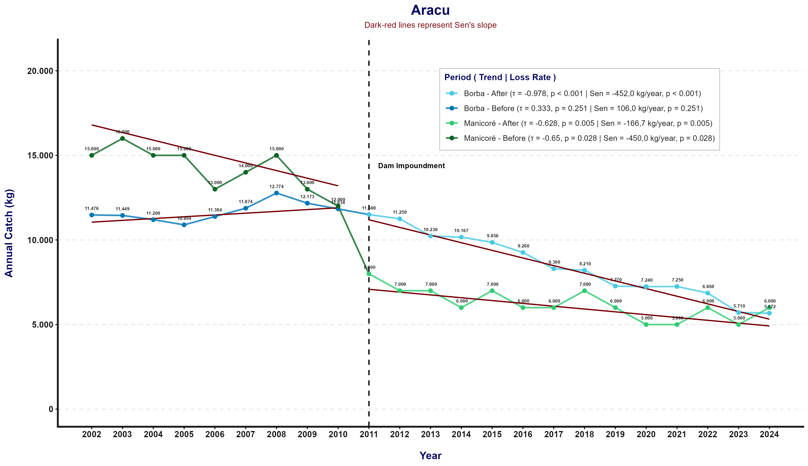{#fig-serie-aracu width="100%" fig-align="center"}

::: {.linha-baixar}
[<i class="bi bi-download"></i> Baixar Gráfico (PNG)](graficos/TimeSeries_Final_Aracu.png){.baixar download="TimeSeries_Final_Aracu.png"}
:::

### Branquinha

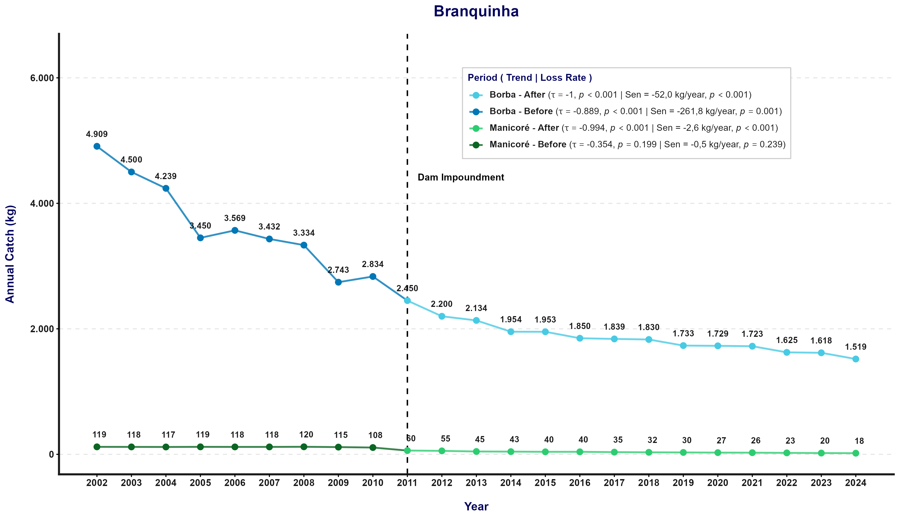{#fig-serie-branquinha width="100%" fig-align="center"}

::: {.linha-baixar}
[<i class="bi bi-download"></i> Baixar Gráfico (PNG)](graficos/TimeSeries_Final_Branquinha.png){.baixar download="TimeSeries_Final_Branquinha.png"}
:::

### Caparari

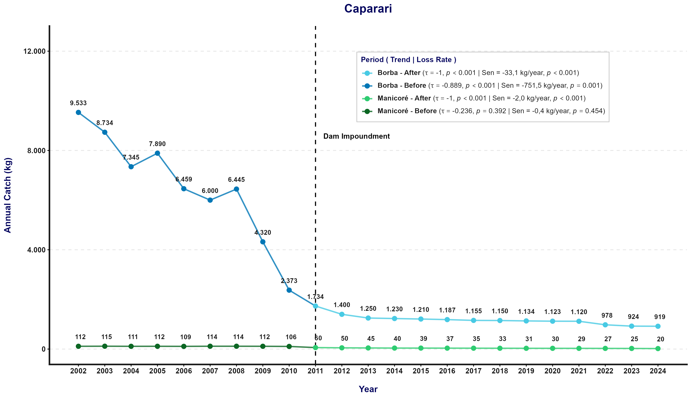{#fig-serie-caparari width="100%" fig-align="center"}

::: {.linha-baixar}
[<i class="bi bi-download"></i> Baixar Gráfico (PNG)](graficos/TimeSeries_Final_Caparari.png){.baixar download="TimeSeries_Final_Caparari.png"}
:::

### Cara branco

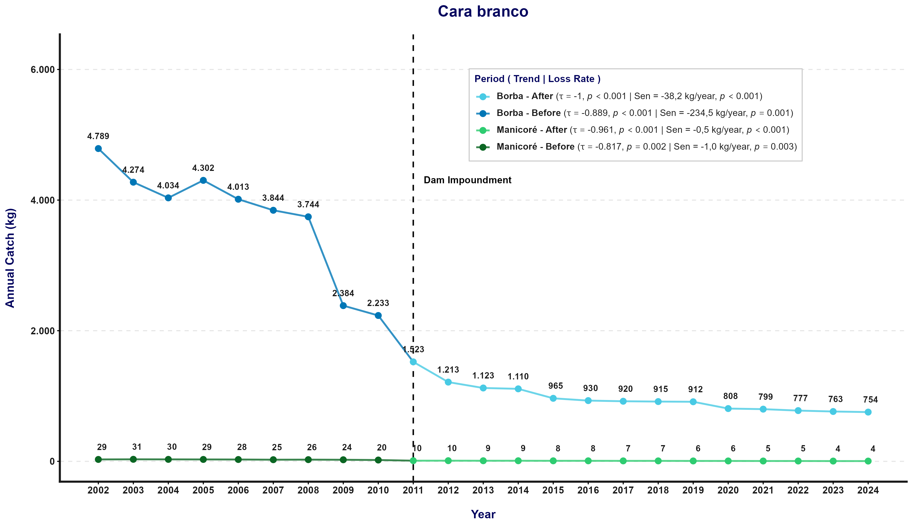{#fig-serie-cara-branco width="100%" fig-align="center"}

::: {.linha-baixar}
[<i class="bi bi-download"></i> Baixar Gráfico (PNG)](graficos/TimeSeries_Final_Cara_branco.png){.baixar download="TimeSeries_Final_Cara_branco.png"}
:::

### Carauaçu

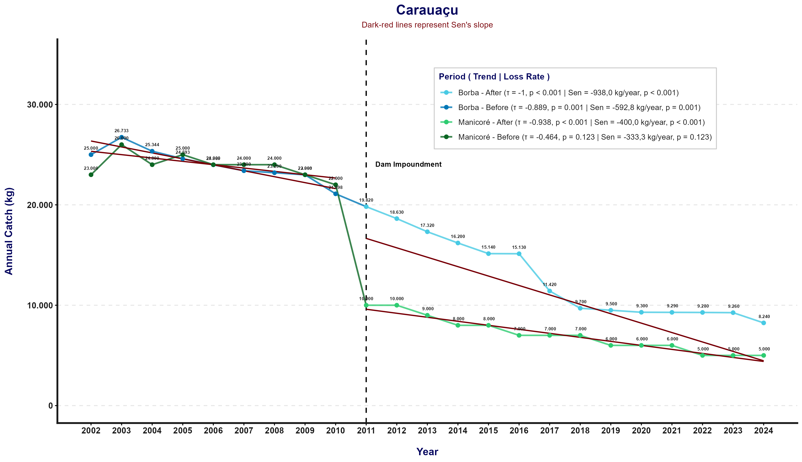{#fig-serie-carauacu width="100%" fig-align="center"}

::: {.linha-baixar}
[<i class="bi bi-download"></i> Baixar Gráfico (PNG)](graficos/TimeSeries_Final_Carauaçu.png){.baixar download="TimeSeries_Final_Carauaçu.png"}
:::

### Curimatã

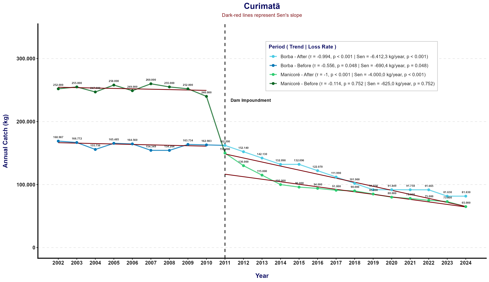{#fig-serie-curimata width="100%" fig-align="center"}

::: {.linha-baixar}
[<i class="bi bi-download"></i> Baixar Gráfico (PNG)](graficos/TimeSeries_Final_Curimatã.png){.baixar download="TimeSeries_Final_Curimatã.png"}
:::

### Dourada

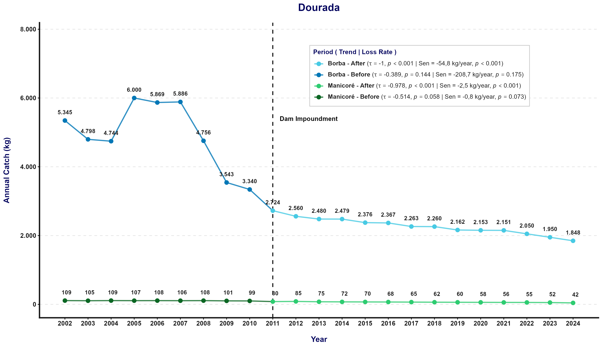{#fig-serie-dourada width="100%" fig-align="center"}

::: {.linha-baixar}
[<i class="bi bi-download"></i> Baixar Gráfico (PNG)](graficos/TimeSeries_Final_Dourada.png){.baixar download="TimeSeries_Final_Dourada.png"}
:::

### Filhote

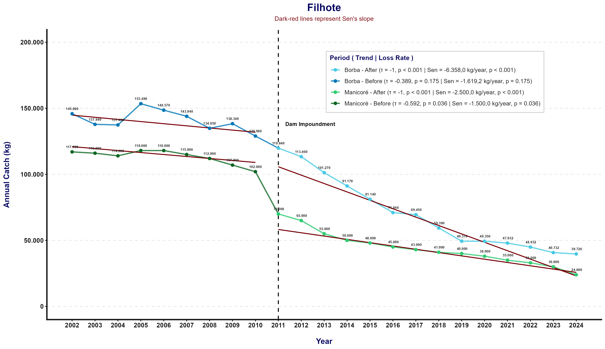{#fig-serie-filhote width="100%" fig-align="center"}

::: {.linha-baixar}
[<i class="bi bi-download"></i> Baixar Gráfico (PNG)](graficos/TimeSeries_Final_Filhote.png){.baixar download="TimeSeries_Final_Filhote.png"}
:::

### Jaraqui

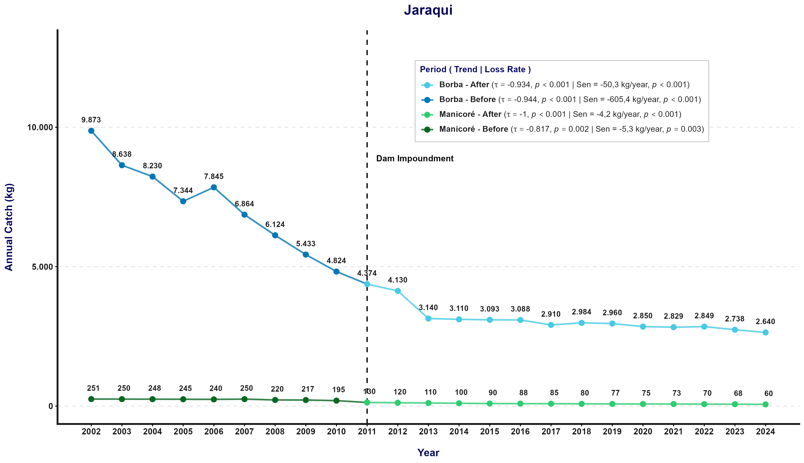{#fig-serie-jaraqui width="100%" fig-align="center"}

::: {.linha-baixar}
[<i class="bi bi-download"></i> Baixar Gráfico (PNG)](graficos/TimeSeries_Final_Jaraqui.png){.baixar download="TimeSeries_Final_Jaraqui.png"}
:::

### Matrinxã

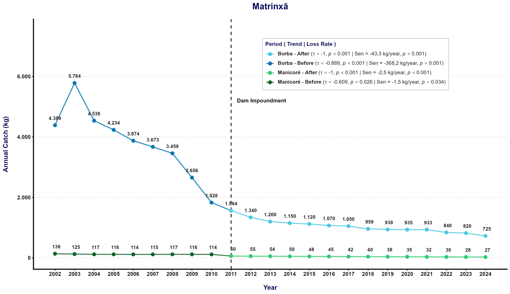{#fig-serie-matrinxa width="100%" fig-align="center"}

::: {.linha-baixar}
[<i class="bi bi-download"></i> Baixar Gráfico (PNG)](graficos/TimeSeries_Final_Matrinxã.png){.baixar download="TimeSeries_Final_Matrinxã.png"}
:::

### Pacu

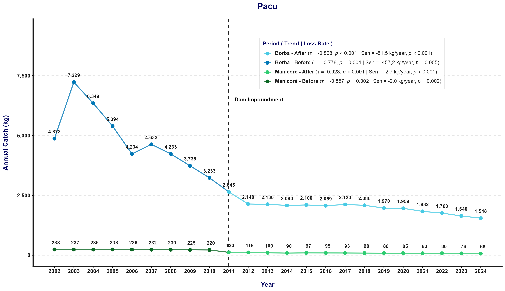{#fig-serie-pacu width="100%" fig-align="center"}

::: {.linha-baixar}
[<i class="bi bi-download"></i> Baixar Gráfico (PNG)](graficos/TimeSeries_Final_Pacu.png){.baixar download="TimeSeries_Final_Pacu.png"}
:::

### Pescada

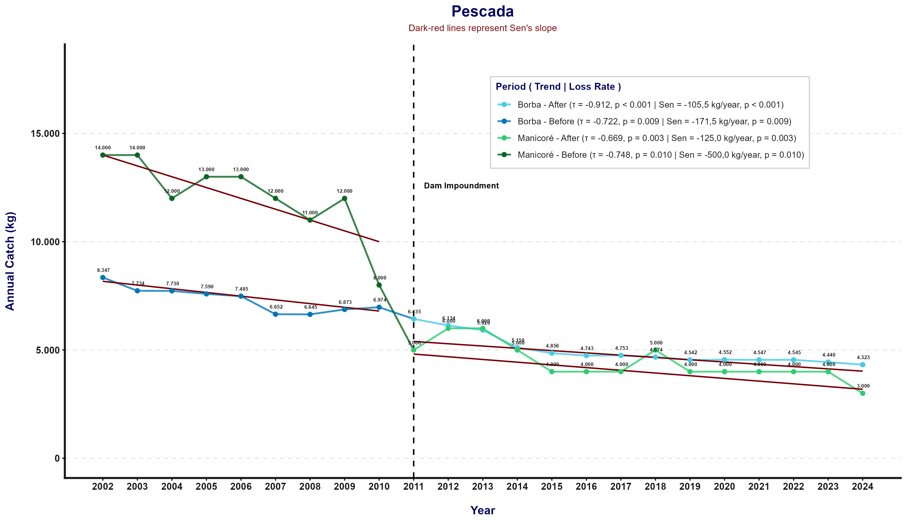{#fig-serie-pescada width="100%" fig-align="center"}

::: {.linha-baixar}
[<i class="bi bi-download"></i> Baixar Gráfico (PNG)](graficos/TimeSeries_Final_Pescada.png){.baixar download="TimeSeries_Final_Pescada.png"}
:::

### Piranambu / Barbado

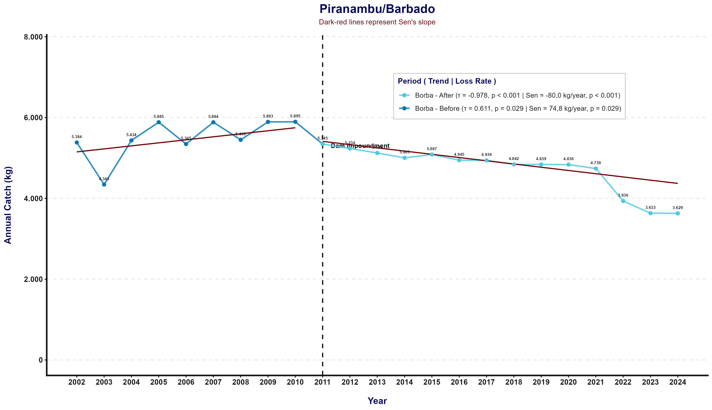{#fig-serie-piranambu-barbado width="100%" fig-align="center"}

::: {.linha-baixar}
[<i class="bi bi-download"></i> Baixar Gráfico (PNG)](graficos/TimeSeries_Final_Piranambu_Barbado.png){.baixar download="TimeSeries_Final_Piranambu_Barbado.png"}
:::

### Pirapitinga

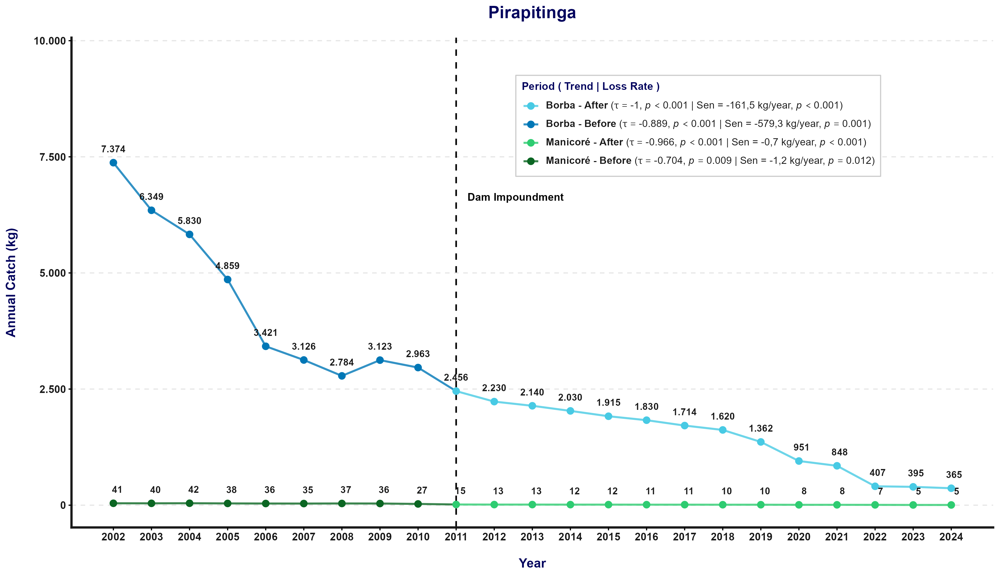{#fig-serie-pirapitinga width="100%" fig-align="center"}

::: {.linha-baixar}
[<i class="bi bi-download"></i> Baixar Gráfico (PNG)](graficos/TimeSeries_Final_Pirapitinga.png){.baixar download="TimeSeries_Final_Pirapitinga.png"}
:::

### Pirarara

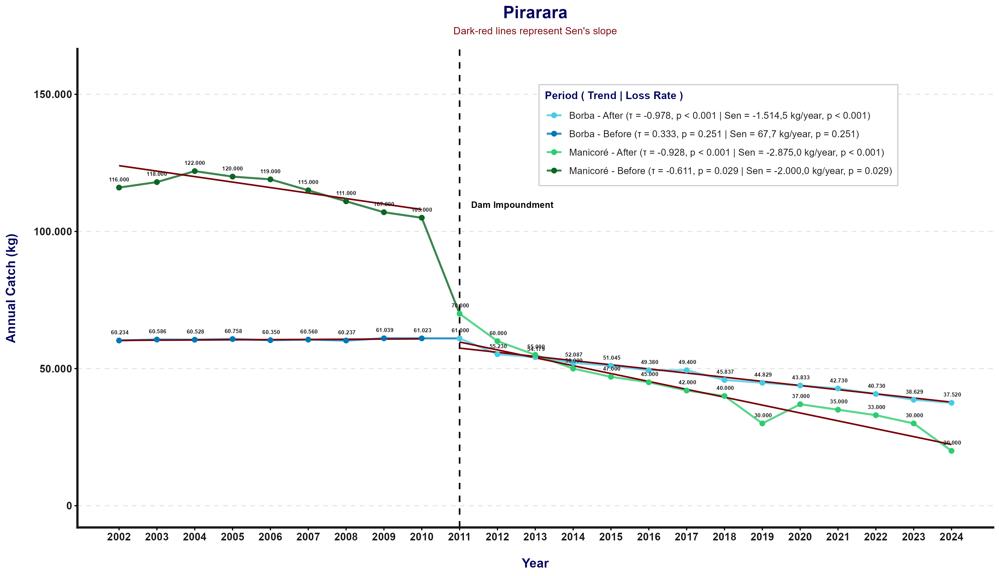{#fig-serie-pirarara width="100%" fig-align="center"}

::: {.linha-baixar}
[<i class="bi bi-download"></i> Baixar Gráfico (PNG)](graficos/TimeSeries_Final_Pirarara.png){.baixar download="TimeSeries_Final_Pirarara.png"}
:::

### Sardinha

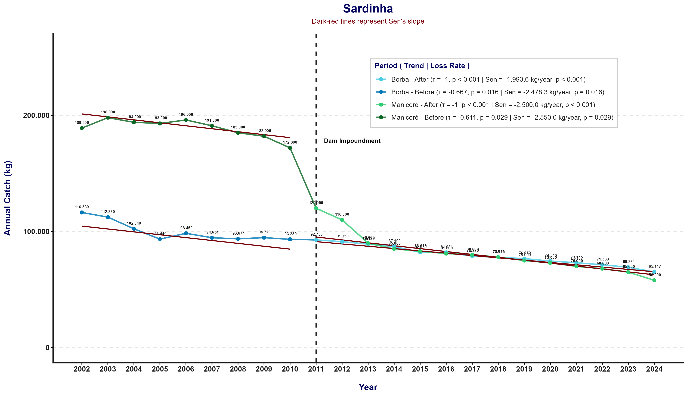{#fig-serie-sardinha width="100%" fig-align="center"}

::: {.linha-baixar}
[<i class="bi bi-download"></i> Baixar Gráfico (PNG)](graficos/TimeSeries_Final_Sardinha.png){.baixar download="TimeSeries_Final_Sardinha.png"}
:::

### Surubim

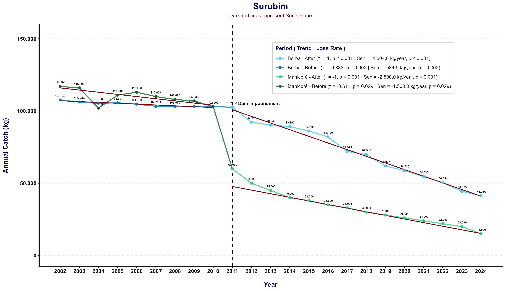{#fig-serie-surubim width="100%" fig-align="center"}

::: {.linha-baixar}
[<i class="bi bi-download"></i> Baixar Gráfico (PNG)](graficos/TimeSeries_Final_Surubim.png){.baixar download="TimeSeries_Final_Surubim.png"}
:::

### Tambaqui

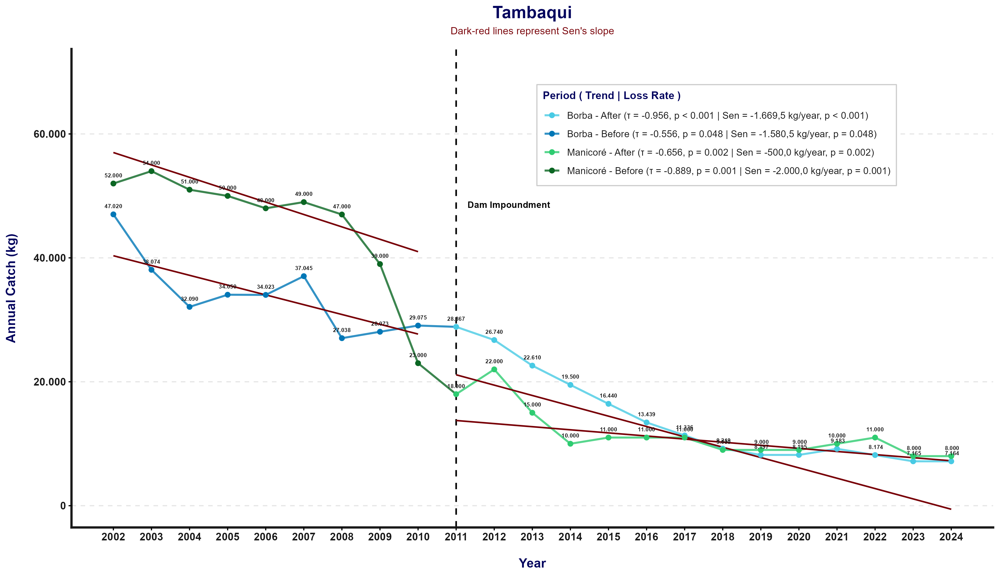{#fig-serie-tambaqui width="100%" fig-align="center"}

::: {.linha-baixar}
[<i class="bi bi-download"></i> Baixar Gráfico (PNG)](graficos/TimeSeries_Final_Tambaqui.png){.baixar download="TimeSeries_Final_Tambaqui.png"}
:::

### Tucunaré

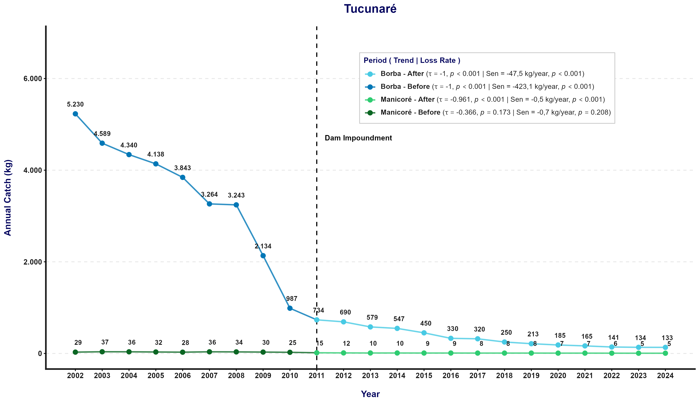{#fig-serie-tucunare width="100%" fig-align="center"}

::: {.linha-baixar}
[<i class="bi bi-download"></i> Baixar Gráfico (PNG)](graficos/TimeSeries_Final_Tucunaré.png){.baixar download="TimeSeries_Final_Tucunaré.png"}
:::

:::

::: {.nota-tabela}
**Notas:** Os pontos representam o volume anual observado | A linha tracejada vertical indica o barramento em 2011 | $\tau$ = coeficiente $\tau$ de Kendall do teste de Mann-Kendall | Os *p*-valores indicam a significância estatística de $\tau$ e da inclinação de Sen | Sen = estimador da inclinação de Sen, que quantifica a taxa anual de variação (taxa de perda), em kg/ano, em cada período e localidade.
:::

### Análise de Tendência Temporal e Autocorrelação para as Cotas Fluviométricas

As @fig-serie-cotas-borba e @fig-serie-cotas-manicore mostram a série temporal do nível médio anual do rio Madeira nas estações de cada município. Inicialmente, a avaliação dos pressupostos indicou que as séries não diferem significativamente da normalidade (Teste de Shapiro-Wilk, $p > 0,05$). Contudo, para lidar com a autocorrelação residual detetada em alguns períodos e manter a consistência metodológica rigorosa adotada nas análises de produção pesqueira, optou-se por abordagens estatísticas não paramétricas.

Para avaliar o comportamento direcional destas séries ao longo do tempo, aplicou-se o teste de Mann-Kendall e a estimativa de Sen's Slope. Adicionalmente, verificou-se a premissa de independência dos resíduos por meio do teste de Durbin-Watson ($d$). Os resultados estão sintetizados na tabela a seguir.

| Município | Período | Série Temporal<br>($n$) | $\tau$ de Kendall | Sen's Slope<br>(cm/ano) | $p$-valor<br>(Mann-Kendall) | Durbin-Watson<br>($d$) | $p$-valor<br>(D.W.) | Tendência |
|:---|:---|:---|:---|:---|:---|:---|:---|:---|
| **Borba** | Antes | 2002–2010 (9) | 0,111 | 3,28 | 0,677 | 1,97 | 0,304 | Estável [—]{style="color:#6c757d; font-weight:700;"} |
|   | Depois | 2011–2024 (14) | −0,253 | −13,20 | 0,208 | 1,29 | 0,037 | Estável [—]{style="color:#6c757d; font-weight:700;"} |
| **Manicoré** | Antes | 2002–2010 (9) | 0,278 | 19,98 | 0,297 | 1,98 | 0,313 | Estável [—]{style="color:#6c757d; font-weight:700;"} |
|   | Depois | 2011–2024 (14) | −0,341 | −16,57 | 0,090 | 1,34 | 0,047 | Estável [—]{style="color:#6c757d; font-weight:700;"} |

: **Testes de tendência de Mann-Kendall, Sen's Slope e verificação de autocorrelação de Durbin-Watson para o nível médio anual do rio Madeira por município e período.** {#tbl-tendencia-cotas}

::: {.nota-tabela}
**Notas:** Foram considerados os períodos 2002–2010 (Antes) e 2011–2024 (Depois) | $n$ = número de anos avaliados em cada período | $\tau$ de Kendall = coeficiente de correlação de postos | Sen's Slope = estimativa não paramétrica da taxa de variação mediana anual (cm/ano) | Durbin-Watson ($d$) = estatística de teste para autocorrelação de primeira ordem nos resíduos (valores próximos de 2 indicam independência) | $p$-valor (D.W.) = significância do teste de autocorrelação ($\alpha = 0,05$) | [—] = ausência de tendência temporal estatisticamente significativa a 5%.
:::

**Comentários:** A avaliação rigorosa dos pressupostos indicou que as séries anuais de cotas assumem uma distribuição normal em todos os cenários (Teste de Shapiro-Wilk: Borba Total $W = 0,957, p = 0,398$; Borba Antes $W = 0,962, p = 0,817$; Borba Depois $W = 0,946, p = 0,494$; Manicoré Total $W = 0,988, p = 0,991$; Manicoré Antes $W = 0,935, p = 0,527$; Manicoré Depois $W = 0,964, p = 0,792$). Contudo, o teste de Durbin-Watson detetou autocorrelação serial significativa na série total para Borba ($d = 1,190; p = 0,010$) e Manicoré ($d = 1,120; p = 0,006$), bem como no período pós-barragem ($p < 0,05$), justificando amplamente o uso de métodos não paramétricos. A análise de tendência demonstra que, a 5% de significância ($\alpha = 0,05$), os níveis fluviométricos mantiveram-se estatisticamente estáveis. No entanto, nota-se uma clara inversão de comportamento capturada pelo *Sen's Slope*: antes do represamento (2002–2010), registava-se uma suave tendência de aumento no volume de água (Borba: 3,28 cm/ano; Manicoré: 19,98 cm/ano); após a barragem (2011–2024), a inclinação tornou-se negativa, sinalizando um ritmo de perda hídrica (-13,20 cm/ano e -16,57 cm/ano). O decréscimo no período "Depois" em Manicoré foi marginalmente significativo ($p = 0,090$). Para confirmar o impacto global absoluto, o Teste de Mann-Whitney atestou que as medianas do nível do rio não sofreram alterações significativas entre as fases Antes e Depois (Borba: $W = 59, p = 0,825$; Manicoré: $W = 51, p = 0,469$).

![Série temporal do nível médio anual (cm) da cota fluviométrica do rio Madeira na estação de Borba entre 2002 e 2024. Os pontos representam a cota anual observada. A linha tracejada vertical indica o ano de início do represamento da barragem (2011). Os valores de $\tau$ são os coeficientes de Kendall resultantes do teste de tendência de Mann-Kendall, os valores de $p$ indicam a significância estatística de $\tau$ e do declive de Sen, e Sen representa o estimador de declive, que quantifica a taxa anual de variação em cm/ano para cada período. O ano de 2025 foi mantido na projeção gráfica apenas para fins de referência visual.](graficos/TimeSeries_Cotas_Borba.png){#fig-serie-cotas-borba width="100%" fig-align="center"}

::: {.linha-baixar}
[<i class="bi bi-download"></i> Baixar Gráfico (PNG)](graficos/TimeSeries_Cotas_Borba.png){.baixar download="TimeSeries_Cotas_Borba.png"}
:::

<br>

![Série temporal do nível médio anual (cm) da cota fluviométrica do rio Madeira na estação de Manicoré entre 2002 e 2024. Os pontos representam a cota anual observada. A linha tracejada vertical indica o ano de início do represamento da barragem (2011). Os valores de $\tau$ são os coeficientes de Kendall resultantes do teste de tendência de Mann-Kendall, os valores de $p$ indicam a significância estatística de $\tau$ e do declive de Sen, e Sen representa o estimador de declive, que quantifica a taxa anual de variação em cm/ano para cada período. O ano de 2025 foi mantido na projeção gráfica apenas para fins de referência visual.](graficos/TimeSeries_Cotas_Manicore.png){#fig-serie-cotas-manicore width="100%" fig-align="center"}

::: {.linha-baixar}
[<i class="bi bi-download"></i> Baixar Gráfico (PNG)](graficos/TimeSeries_Cotas_Manicore.png){.baixar download="TimeSeries_Cotas_Manicore.png"}
:::


## Apêndices

Nesta seção, apresentamos os detalhamentos metodológicos, as demonstrações algébricas, as formulações matemáticas dos testes estatísticos e os materiais complementares que fundamentam os resultados apresentados ao longo deste documento.

::: {#calc-taxa-declinio .metodo .metodo-taxa}
**Taxa de Declínio Produtivo**

Representa a redução percentual da produção pesqueira média anual (em kg) entre os períodos "Antes" (2002 a 2010) e "Depois" (2011 a 2024) da instalação das UHEs, compondo os resultados descritivos da @tbl-estatisticas-pesca e sendo calculada pela seguinte fórmula geral:

$$
\Delta P = \left( \frac{ \bar{X}_{\text{Antes}} - \bar{X}_{\text{Depois}} }{ \bar{X}_{\text{Antes}} } \right) \times 100
$$

Os cálculos específicos para cada município, utilizando as médias anuais exatas da série histórica, são apresentados a seguir:

::: {.calc-taxas style="display: flex; justify-content: space-between; font-size: 0.85em; margin-top: 15px;"}

::: {.calc-col style="width: 48%; border-right: 2px solid #d3d3d3; padding-right: 15px;"}

**Borba**

$$
\small
\Delta P_{\text{Borba}} = \left( \frac{ 1.499.501 - 964.113 }{ 1.499.501 } \right) \times 100 = 35{,}7\%
$$

:::

::: {.calc-col style="width: 48%; padding-left: 15px;"}

**Manicoré**

$$
\small
\Delta P_{\text{Manicoré}} = \left( \frac{ 1.891.111 - 706.214 }{ 1.891.111 } \right) \times 100 = 62{,}7\%
$$

:::

:::
:::


::: {#met-shapiro-wilk .metodo .metodo-normalidade}
**Shapiro-Wilk**

Verifica se uma amostra pode ser considerada proveniente de uma distribuição normal. Sua estatística de teste é $W$, e ele é indicado para amostras pequenas, como as deste estudo (9 e 14 anos). Um $p$-valor maior que $\alpha$ indica que não há evidência contra a normalidade. As hipóteses são:

- $H_0$: os dados seguem uma distribuição normal;
- $H_1$: os dados não seguem uma distribuição normal.
:::

::: {#met-anderson-darling .metodo .metodo-normalidade}
**Anderson-Darling**

Também avalia a normalidade dos dados, com estatística de teste $A$. Ele dá mais peso aos valores extremos da distribuição e, por isso, foi utilizado de forma complementar ao de Shapiro-Wilk. As hipóteses são:

- $H_0$: os dados seguem uma distribuição normal;
- $H_1$: os dados não seguem uma distribuição normal.
:::

::: {#met-welch .metodo .metodo-param}
**T de Welch para amostras independentes**

Compara as médias de dois grupos independentes. Exige que os dados de cada grupo sejam normais, mas não exige que as variâncias sejam iguais. Sua estatística de teste é $t$, e ele foi utilizado quando os dois períodos atenderam à normalidade. As hipóteses são:

- $H_0$: $\mu_{\text{Antes}} = \mu_{\text{Depois}}$ (as médias dos dois períodos são iguais);
- $H_1$: $\mu_{\text{Antes}} \neq \mu_{\text{Depois}}$ (as médias dos dois períodos são diferentes).
:::

::: {#met-wilcoxon .metodo .metodo-nparam}
**Wilcoxon-Mann-Whitney para amostras independentes**

Compara dois grupos independentes a partir da ordenação (postos) das observações, sem exigir normalidade. Sua estatística de teste é $W$, e ele foi utilizado quando ao menos um período não atendeu à normalidade. As hipóteses são:

- $H_0$: os dois períodos têm a mesma distribuição de produção;
- $H_1$: os dois períodos têm distribuições de produção diferentes.
:::


::: {#calc-composicao-especies .metodo .metodo-composicao}
**Métricas de Alteração da Composição das Capturas**

As alterações na composição das capturas pesqueiras foram descritas a partir de três medidas complementares: a variação percentual da captura média anual de cada espécie, sua participação relativa na produção pesqueira total de cada ano e a mudança dessa participação entre os períodos (Antes) e (Depois). Essas medidas fundamentam os resultados apresentados na @tbl-composicao-especies.

#### Variação percentual da captura por espécie

A variação percentual da captura representa a mudança relativa na captura média anual de cada espécie entre os períodos (Antes) e (Depois), sendo calculada por:

$$
V_i =
\left(
\frac{
\bar{X}_{i,\text{Depois}} -
\bar{X}_{i,\text{Antes}}
}{
\bar{X}_{i,\text{Antes}}
}
\right)
\times 100,
$$

em que $\bar{X}_{i,\text{Antes}}$ e $\bar{X}_{i,\text{Depois}}$ representam, respectivamente, as capturas médias anuais da espécie $i$ nos períodos (Antes) e (Depois).

Valores negativos indicam redução da captura média anual, enquanto valores positivos indicam aumento.

Como exemplo, para o Filhote em Borba:

$$
\small
V_{\text{Filhote}}
=
\left(
\frac{
69.911 - 141.030
}{
141.030
}
\right)
\times 100
=
-50{,}43\%.
$$

Portanto, a captura média anual do Filhote foi aproximadamente 50,43% menor no período (Depois).

Para a Dourada em Manicoré:

$$
\small
V_{\text{Dourada}}
=
\left(
\frac{
64.285{,}71 - 105.777{,}78
}{
105.777{,}78
}
\right)
\times 100
=
-39{,}23\%.
$$

Assim, a captura média anual da Dourada apresentou redução de aproximadamente 39,23%.

---

#### Participação relativa anual das espécies

A participação relativa indica quanto cada espécie representa da produção pesqueira total registrada em determinado município e ano.

Para a espécie $i$, no ano $t$, foi calculada por:

$$
p_{it}
=
\left(
\frac{
X_{it}
}{
X_{\cdot t}
}
\right)
\times 100,
$$

em que $X_{it}$ corresponde à captura da espécie $i$ no ano $t$ e $X_{\cdot t}$ representa a captura total de todas as espécies registradas no mesmo município e ano.

Dessa forma, uma participação de 10%, por exemplo, indica que a espécie respondeu por 10% de toda a produção pesqueira registrada naquele ano.

Após o cálculo das participações anuais, foi obtida a participação média de cada espécie dentro de cada período:

$$
\bar{p}_{i,j}
=
\frac{1}{n_j}
\sum_{t=1}^{n_j} p_{it},
$$

em que $j$ representa o período (Antes) ou (Depois), e $n_j$ corresponde ao número de anos pertencentes ao respectivo período.

Assim:

$$
n_{\text{Antes}}=9
\qquad\text{e}\qquad
n_{\text{Depois}}=14.
$$

Portanto, a participação média apresentada na @tbl-composicao-especies corresponde à média das participações relativas anuais da espécie, e não à simples razão entre duas médias de captura.

---

#### Mudança na participação relativa

A alteração na composição foi quantificada pela diferença entre a participação média da espécie no período (Depois) e sua participação média no período (Antes):

$$
\Delta p_i
=
\bar{p}_{i,\text{Depois}}
-
\bar{p}_{i,\text{Antes}}.
$$

Como ambas as medidas são percentuais, essa diferença é expressa em **pontos percentuais (p.p.)**.

Valores positivos indicam ganho de participação relativa na composição das capturas, enquanto valores negativos indicam perda de participação.

Como exemplo, para o Filhote em Borba:

$$
\small
\Delta p_{\text{Filhote}}
=
7{,}01 - 9{,}41
=
-2{,}40\text{ p.p.}
$$

Portanto, além da redução de 50,43% na captura média anual, o Filhote perdeu aproximadamente 2,40 pontos percentuais de participação na composição das capturas.

Por outro lado, para a Dourada em Borba:

$$
\small
\Delta p_{\text{Dourada}}
=
8{,}92 - 7{,}01
=
+1{,}91\text{ p.p.}
$$

Embora sua captura média anual tenha apresentado redução de 19,68%, sua participação relativa aumentou em aproximadamente 1,91 ponto percentual. Esse resultado ocorre porque a mudança na composição depende da participação da espécie na produção total, e não apenas da alteração de sua captura absoluta.

Da mesma forma, para a Dourada em Manicoré:

$$
\small
\Delta p_{\text{Dourada}}
=
9{,}22 - 5{,}60
=
+3{,}62\text{ p.p.}
$$

Nesse caso, embora a captura média anual tenha diminuído 39,23%, a espécie aumentou sua participação relativa na composição das capturas em aproximadamente 3,62 pontos percentuais.
:::
